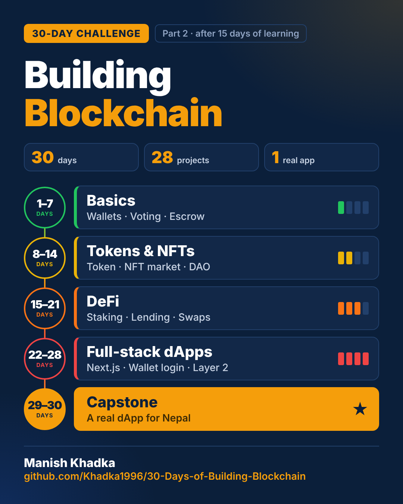

# 30 Days of Building Blockchain

Part 2 of my blockchain journey. In [Part 1 — Learning Blockchain in 15 Days](https://github.com/Khadka1996/Learning-Blockchain) I learned the concepts, from a single hash to a full-stack dApp ([free 84-page study guide](https://github.com/Khadka1996/Learning-Blockchain/tree/main/guide)).

Now I **build**: one small, complete, tested project every day for 30 days, going from very simple to complex, and finishing with one real app for Nepal.

**Dates:** Day 1 is 31 October 2026 · Day 30 is 29 November 2026 · a new project every day at 5:30 pm Nepal time

**Author:** [Manish Khadka](https://khadka-manish.com.np) · [LinkedIn](https://www.linkedin.com/in/manishkhadka1996) · [GitHub](https://github.com/Khadka1996)



---

## At a glance

| | Days | Focus | Level |
|---|---|---|:---:|
| **Week 1** | 1–7 | Solidity basics: small contracts, access control, sending ETH safely | 🟢 |
| **Week 2** | 8–14 | Tokens and NFTs as real products | 🟡 |
| **Week 3** | 15–21 | DeFi: staking, lending, swaps, stablecoins, vaults, security | 🟠 |
| **Week 4** | 22–27 | Full-stack dApps: web apps, wallet login, gasless, Layer 2 | 🔴 |
| **Capstone** | 28–30 | One complete dApp for a real problem in Nepal | ⭐ |

**30 days · 27 projects · 1 capstone app**

## How every day works

1. **Build:** one focused project with clean, commented code.
2. **Test:** unit tests, plus fuzz and invariant tests where they matter.
3. **Attack and fix:** a security review of the day's code; every bug found is fixed and proven with a test (`QA.md`).
4. **Explain:** a short README in plain words: what it does, how it works, what I learned.
5. **Share:** a daily LinkedIn post with a simple card.

## Full roadmap

More detail for every day (new skills and security focus): **[ROADMAP.md](ROADMAP.md)**

### Week 1 — Solidity building blocks 🟢

| Day | Project | What I build | Status |
|----:|---------|--------------|:------:|
| 01 | [To-do list](day-01) | Add, complete and delete tasks; only you can edit your list | ✅ |
| 02 | [Piggy bank with a time lock](day-02) | Deposit ETH; withdraw only after an unlock date | ✅ |
| 03 | [Voting app](day-03) | Polls with one vote per address and a deadline | ✅ |
| 04 | [Multisig wallet](day-04) | 3 owners; any payment needs 2 approvals | ✅ |
| 05 | [Escrow](day-05) | Money held safely until the buyer receives the item | ✅ |
| 06 | [Crowdfunding](day-06) | Reach the goal or every backer gets a refund | ✅ |
| 07 | [Week 1 recap + deploy kit](day-07) | Review the week; deploy script and Etherscan verification | ✅ |

### Week 2 — Tokens and NFTs as products 🟡

| Day | Project | What I build | Status |
|----:|---------|--------------|:------:|
| 08 | [My own token + faucet](day-08) | An ERC-20 token and a once-a-day faucet | ✅ |
| 09 | [Token vesting](day-09) | Team tokens unlock slowly over 12 months | ✅ |
| 10 | [Airdrop with Merkle proofs](day-10) | 1,000 people can claim; one hash stored on-chain | ✅ |
| 11 | [NFT collection](day-11) | Allowlist mint, public sale, max supply | ✅ |
| 12 | NFT marketplace | List, buy and cancel; creators get royalties | ⏳ |
| 13 | [Auction](day-13) | English (rising) and Dutch (falling price) auctions | ✅ |
| 14 | [DAO](day-14) | Token holders vote; passed proposals run after a delay | ✅ |

### Week 3 — DeFi 🟠

Simplified teaching versions; each README explains what a real protocol adds.

| Day | Project | What I build | Status |
|----:|---------|--------------|:------:|
| 15 | [Staking with rewards](day-15) | Lock tokens, earn rewards every second | ✅ |
| 16 | Mini lending pool | Deposit, borrow against collateral, liquidations | ⏳ |
| 17 | Swap with a router | Swap pools and multi-hop routes A → B → C | ⏳ |
| 18 | Flash loans | Borrow and repay in one transaction | ⏳ |
| 19 | Mini stablecoin | Lock ETH, mint a dollar-pegged coin | ⏳ |
| 20 | Yield vault | ERC-4626 vault that shares profit fairly | ⏳ |
| 21 | Security & upgrades day | Fuzz and invariant attacks on Week 3; a safe UUPS upgrade | ⏳ |

### Week 4 — Full-stack dApps 🔴

| Day | Project | What I build | Status |
|----:|---------|--------------|:------:|
| 22 | Next.js dApp | A web app for the Week 1 contracts with wallet connect | ⏳ |
| 23 | Reading events | A live activity feed and simple indexer | ⏳ |
| 24 | Sign in with Ethereum | Log in with a wallet instead of a password | ⏳ |
| 25 | Gasless transactions | Users act without ETH; a relayer pays the gas | ⏳ |
| 26 | Layer 2 & cross-chain | Compare costs on two chains and send messages between them | ⏳ |
| 27 | Monitoring & alerts | A dashboard that watches a contract and flags unusual activity | ⏳ |

### Days 28–30 — Capstone ⭐

| Day | Project | What I build | Status |
|----:|---------|--------------|:------:|
| 28 | Capstone, part 1 | Design and contracts for a dApp for a real problem in Nepal | ⏳ |
| 29 | Capstone, part 2 | The web app, end-to-end tests and a deploy kit | ⏳ |
| 30 | Capstone, part 3 | Self-audit, live demo on a test network, 30-day wrap-up | ⏳ |

## How it runs

- Every project is built and tested on a **local blockchain (Hardhat)**, so every result is real and repeatable.
- **Live test-network deployments** (Sepolia) are done from my own laptop with a test-only wallet and free faucet ETH. No real money, and no private keys in this repository.
- **Foundry** is practised on my own machine; the daily runs use Hardhat with fast-check fuzzing.

## Repository structure

```
30-Days-of-Building-Blockchain/
├── ROADMAP.md         # detailed plan for every day
├── roadmap/           # roadmap banner
├── day-01/            # one folder per day
│   ├── README.md      # what I built, how it works, results
│   ├── contracts/     # Solidity
│   ├── test/          # tests
│   ├── QA.md          # security review: bugs found → fixes
│   └── card/          # the day's LinkedIn card
├── ...
└── tools/             # shared templates (card design, post style)
```

## Tech stack

Solidity · Hardhat · OpenZeppelin · ethers.js · fast-check · Next.js · wagmi / viem · Sepolia test network (no real money)

## Follow along

A new project every day on [LinkedIn](https://www.linkedin.com/in/manishkhadka1996).
