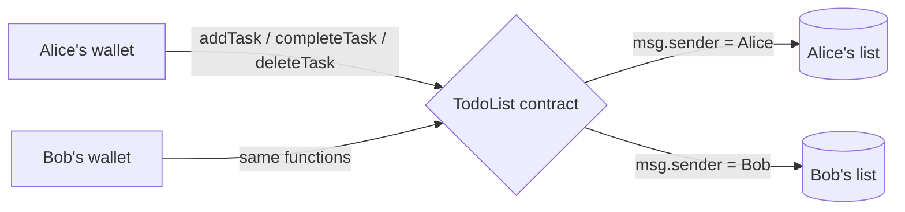

# Day 01 — To-do list on the blockchain

## What I built

A to-do list that lives in a smart contract. Every wallet address gets its own list: you can add tasks, mark them done and delete them, and **nobody else can touch your list**.

## How it works

1. You call `addTask("Buy milk")`. The contract saves the task under **your address** and gives it an ID (1, 2, 3…).
2. `completeTask(id)` and `deleteTask(id)` only ever look inside the caller's own list (`msg.sender`). If Bob asks to delete task 1, the contract looks in **Bob's** list, not Alice's.
3. Each task keeps the same ID forever, even after other tasks are deleted, so you never complete the wrong one.
4. Every change emits an event (`TaskAdded`, `TaskCompleted`, `TaskDeleted`) so apps can follow along.



Think of it like a building with one locker per person: the key is your wallet, and the locker number is your address. You can only open your own locker.

**Limits:** task text is 1–280 bytes, and each person can hold up to 100 tasks at once (keeps storage and reads cheap).

## Run it yourself

```bash
git clone https://github.com/Khadka1996/30-Days-of-Building-Blockchain.git
cd 30-Days-of-Building-Blockchain/day-01
npm install --legacy-peer-deps
npm test          # 15 tests, including 50 random fuzz runs
npm run demo      # deploys to a local chain and prints gas per action
npm run lint      # solhint
```

## Results from my run

```
15 passing (3s)

TodoList deployed at 0x5FbDB2315678afecb367f032d93F642f64180aa3
addTask("Buy milk")          gas used: 138255
addTask("Learn Solidity")    gas used: 104127
completeTask(1)              gas used: 33405
deleteTask(1)                gas used: 50748
Alice's list now: [ '#2 Learn Solidity (open)' ]
```

slither: 0 results · solhint: 0 warnings · npm audit: 0 vulnerabilities

The first `addTask` costs more than the second because it writes your ID counter and list length for the first time (a fresh storage slot costs more than updating one).

## What I learned

- **`msg.sender` is the simplest access control.** If a function has no "owner" parameter, a caller can't even ask to edit someone else's data.
- **Array positions make bad IDs.** Deleting with swap-and-pop moves items around; a stable ID plus an `id → index` map keeps everything correct.
- **"Private" on a blockchain means "only I can change it", not "only I can see it".** Anyone can read contract storage.

## Security notes

Six findings from the review, all fixed or documented and each proven with a test: see **[QA.md](QA.md)**.

## References

- [Solidity docs — Mappings](https://docs.soliditylang.org/en/v0.8.24/types.html#mapping-types)
- [Solidity docs — Structs and arrays](https://docs.soliditylang.org/en/v0.8.24/types.html#structs)
- [Solidity docs — Custom errors](https://docs.soliditylang.org/en/v0.8.24/contracts.html#errors-and-the-revert-statement)
- [Hardhat — Testing contracts](https://hardhat.org/hardhat-runner/docs/guides/test-contracts)
- [fast-check — Property-based testing](https://fast-check.dev/)

## Next

**Day 02 — Piggy bank with a time lock:** deposit ETH and withdraw only after an unlock date.
