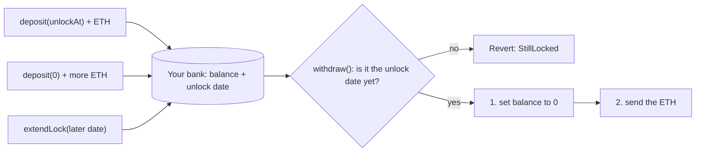

# Day 02 — Piggy bank with a time lock

## What I built

A piggy bank that lives in a smart contract. You put ETH in and choose an unlock date. Until that date **nobody can take the money out, not even you**, and after it only you can.

## How it works

1. `deposit(unlockAt)` with some ETH opens your bank and sets the unlock date (a unix timestamp in seconds, in the future, at most 10 years away).
2. Want to save more? Call `deposit(0)` with more ETH: it goes into the same bank with the same date.
3. `extendLock(newDate)` pushes the date **later**. There is no way to move it earlier.
4. `withdraw()` checks the clock (`block.timestamp`). Too early → it reverts with `StillLocked`. On or after the date → you get **all** your ETH back and the bank is reset for a new goal.
5. The withdrawal follows **checks → effects → interaction**: check the rules, set your balance to zero, and only then send the ETH.



Think of a clay piggy bank with a timer: you can always drop coins in, but the slot only opens when the timer says so. Why zero the balance **before** sending? Imagine a cashier who hands you cash and only then crosses your name off the list: you could step back into the queue and get paid again. Crossing the name off first closes that trick (it is called **reentrancy**).

**Limits:** no admin and no emergency exit; locks are at most 10 years; plain ETH sent without `deposit()` is rejected.

## Run it yourself

```bash
git clone https://github.com/Khadka1996/30-Days-of-Building-Blockchain.git
cd 30-Days-of-Building-Blockchain/day-02
npm install --legacy-peer-deps
npm test          # 22 tests, including attack tests and 50 random fuzz runs
npm run demo      # save, try early, jump 37 days, withdraw (prints gas)
npm run lint      # solhint
npm run slither   # needs: pip install slither-analyzer
```

## Results from my run

```
22 passing (3s)

PiggyBank deployed at 0x5FbDB2315678afecb367f032d93F642f64180aa3
deposit 1 ETH, lock 30 days        gas used: 70144
deposit 0.5 ETH more               gas used: 35302
extendLock +7 days                 gas used: 29577
Time left: 37.0 days
withdraw() today: reverted with StillLocked
...37 days later...
withdraw()                         gas used: 33080
Alice got back 1.5000 ETH (1.5 ETH minus a tiny gas fee)
Total still locked: 0.0 ETH
```

solhint: 0 warnings · npm audit: 0 vulnerabilities · slither: 4 informational results (timestamp use and the deliberate low-level `call`), both reviewed and accepted in [QA.md](QA.md)

The first deposit costs about twice the second because it writes the unlock date and fresh storage slots for the first time.

## What I learned

- **Order matters when sending ETH.** Check, then update your records, then send. Sending first lets a malicious contract call back in and withdraw twice.
- **`transfer()` is no longer the safe choice.** Its 2,300-gas limit blocks smart-contract wallets; `call` plus a checked result (and the right order) is the modern pattern.
- **Never trust `address(this).balance` for accounting.** Anyone can force ETH into a contract, so keep your own totals.

## Security notes

Nine findings from the review (one high, two medium), all fixed or documented and each proven with a test: see **[QA.md](QA.md)**.

## References

- [Solidity docs — Sending and receiving Ether](https://docs.soliditylang.org/en/v0.8.24/security-considerations.html#sending-and-receiving-ether)
- [Solidity docs — Checks-Effects-Interactions pattern](https://docs.soliditylang.org/en/v0.8.24/security-considerations.html#use-the-checks-effects-interactions-pattern)
- [Solidity docs — Block and transaction properties](https://docs.soliditylang.org/en/v0.8.24/units-and-global-variables.html#block-and-transaction-properties)
- [Hardhat Network Helpers — time](https://hardhat.org/hardhat-network-helpers/docs/reference#time-helpers)
- [SWC-107 — Reentrancy](https://swcregistry.io/docs/SWC-107)

## Next

**Day 03 — Voting app:** create a poll, one vote per address, and show the winner after a deadline.
