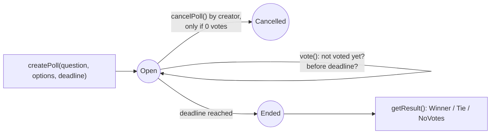

# Day 03 — Voting app

## What I built

A voting app in a smart contract. Anyone can create a poll with 2–10 answers and a closing time. Every address gets **one vote per poll**, only **before the deadline**, and once the deadline passes anyone can read the result: a winner, a tie, or no votes.

## How it works

1. `createPoll(question, options, deadline)` saves the poll and gives it an id (1, 2, 3…). The deadline must be 5 minutes to 30 days away.
2. `vote(pollId, option)` checks three things with **modifiers** (small reusable checks that run before a function): the poll exists, it is still open, and you have not voted yet. Then it marks you as "voted" and adds one to your option.
3. `status(pollId)` returns an **enum** (a fixed list of named states): `Open`, `Ended` or `Cancelled`. It is worked out from the clock, so it is always correct without anyone having to "close" the poll.
4. `getResult(pollId)` only works once the poll has `Ended`, and returns `Winner`, `Tie` or `NoVotes` plus the top score.
5. `cancelPoll(pollId)`: the creator can cancel, but only **before anyone has voted**.



Think of a school election with a register at the door: your name is ticked off the moment you vote, so you cannot come back for a second ballot, and the doors lock at exactly 5 pm. The results are only read out after the doors are locked.

**Limits:** one vote per **address**, not per person (anyone can make more addresses); votes are public; deadlines cannot be moved. See [QA.md](QA.md) for why.

## Run it yourself

```bash
git clone https://github.com/Khadka1996/30-Days-of-Building-Blockchain.git
cd 30-Days-of-Building-Blockchain/day-03
npm install --legacy-peer-deps
npm test          # 24 tests, including attack tests and 50 random fuzz runs
npm run demo      # create a poll, 5 votes, a double vote, a late vote, the winner (prints gas)
npm run lint      # solhint
npm run slither   # needs: pip install slither-analyzer
```

## Results from my run

```
24 passing (4s)

Voting deployed at 0x5FbDB2315678afecb367f032d93F642f64180aa3
createPoll (3 options, 3 days)       gas used: 215084
first vote                           gas used: 101127
5 votes cast
Bob votes again:                     reverted with AlreadyVoted
Result before deadline:              reverted with ResultNotReady
...3 days later...
Frank votes late:                    reverted with PollNotOpen
  Buff     1 vote(s)
  Chicken  3 vote(s)
  Veg      1 vote(s)
Result: Winner — Chicken with 3 of 5 votes
```

solhint: 0 warnings · npm audit: 0 vulnerabilities · slither: 0 results (one `timestamp` note reviewed and accepted in [QA.md](QA.md))

Creating a poll costs the most gas because the question and every option are written to storage for the first time.

## What I learned

- **Mark first, count second.** Recording "this address has voted" before adding the vote is what stops double voting; the fuzz test checks it in 50 random runs.
- **Use one rule for time.** Voting while `now < deadline` and results when `now >= deadline` leaves no second where both are possible.
- **Enums make results honest.** Returning `Winner`, `Tie` or `NoVotes` is clearer and safer than quietly picking the first option on a tie.

## Security notes

Eight findings from the review (one high, four medium), all fixed or documented and each proven with a test, plus three known design limits: see **[QA.md](QA.md)**.

## References

- [Solidity by Example — Voting](https://docs.soliditylang.org/en/v0.8.24/solidity-by-example.html#voting)
- [Solidity docs — Enums](https://docs.soliditylang.org/en/v0.8.24/types.html#enums)
- [Solidity docs — Function modifiers](https://docs.soliditylang.org/en/v0.8.24/contracts.html#function-modifiers)
- [Solidity docs — Block and transaction properties](https://docs.soliditylang.org/en/v0.8.24/units-and-global-variables.html#block-and-transaction-properties)
- [Ethereum.org glossary — Sybil attack](https://ethereum.org/en/glossary/#sybil-attack)

## Next

**Day 04 — Multisig wallet:** 3 owners, and any payment needs 2 approvals.
