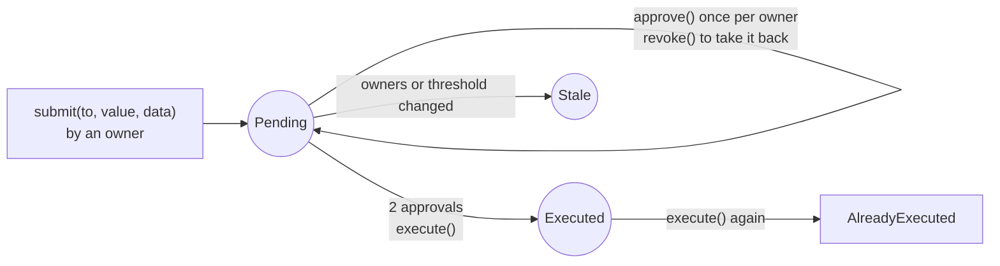

# Day 04 — Multisig wallet

## What I built

A shared wallet in a smart contract with **3 owners**, where **any payment needs 2 approvals**. One owner proposes a payment, a second owner approves it, and only then can it be sent, and only **once**. Owners can also be added or removed, but only through the same 2-of-3 vote.

## How it works

1. `submit(to, value, data)`: an owner proposes a transaction (send ETH, call a contract, or both). It gets an id: 0, 1, 2…
2. `approve(txId)`: each owner can approve a proposal **once**. `revoke(txId)` takes an approval back before it runs.
3. `execute(txId)`: once 2 owners have approved, any owner can run it. The wallet marks it as **executed before sending**, so it can never run twice.
4. `addOwner`, `removeOwner`, `changeThreshold`: can only be called **by the wallet itself**, which means through a proposal that 2 owners approved.
5. Every owner change bumps a **config version**. Proposals from the old owner set become **stale**, so an approval from a removed owner can never be used.



Think of a family savings account at a bank where the form needs **two signatures** from Ram, Sita and Hari. Each person can sign a form only once, a paid form is stamped "PAID" so it cannot be cashed again, and if Hari leaves the family account, any form he already signed must be filled in and signed again.

**Limits:** approvals are on-chain (each costs gas); an owner change cancels every open proposal; the wallet will call whatever the owners approve. See [QA.md](QA.md) for why.

## Run it yourself

```bash
git clone https://github.com/Khadka1996/30-Days-of-Building-Blockchain.git
cd 30-Days-of-Building-Blockchain/day-04
npm install --legacy-peer-deps
npm test          # 25 tests, including attack tests and 50 random fuzz runs
npm run demo      # a 2-of-3 payment, a double approval, a replay and a removed owner (prints gas)
npm run lint      # solhint
npm run slither   # needs: pip install slither-analyzer
```

## Results from my run

```
25 passing (2s)

MultiSigWallet deployed at 0x5FbDB2315678afecb367f032d93F642f64180aa3 (owners: Ram, Sita, Hari · 2 approvals needed)
Wallet balance:                        5.0 ETH
Ram submits: pay shop 1 ETH            gas used: 103312
Ram approves                           gas used: 77730
Ram approves again:                    reverted with AlreadyApproved
Execute with 1 approval:               reverted with NotEnoughApprovals
Sita approves                          gas used: 60630
Sita executes                          gas used: 56457
Replay the same payment:               reverted with AlreadyExecuted
Hari removed. Owners left:             2
Ram approves Hari's old proposal:      reverted with StaleTransaction
Hari tries to propose:                 reverted with NotOwner
Wallet balance:                        4.0 ETH
Shop balance change:                   +1.0 ETH (paid exactly once)
```

solhint: 0 warnings · npm audit: 0 vulnerabilities · slither: 0 results

The first approval costs more gas than the second (77,730 vs 60,630) because it writes a brand-new storage slot for the approval count.

## What I learned

- **Mark it done before you pay.** Setting `executed = true` before the external call is what makes replay impossible, even if the receiver calls back into the wallet.
- **Counting approvals is not enough; remember who approved.** A per-owner record stops double approvals, and a config version stops a removed owner's old approval from counting.
- **Admin actions need the same vote as money.** If one owner could add owners alone, the 2-of-3 rule would mean nothing.

## Security notes

Eleven findings from the review (four high, two medium), all fixed and each proven with a test, plus four known design limits: see **[QA.md](QA.md)**.

## References

- [Safe (Gnosis Safe) smart account contracts](https://github.com/safe-global/safe-smart-account)
- [Solidity by Example — Multi-Sig Wallet](https://solidity-by-example.org/app/multi-sig-wallet/)
- [Solidity docs — Security considerations (re-entrancy)](https://docs.soliditylang.org/en/v0.8.24/security-considerations.html#reentrancy)
- [Solidity docs — Low-level calls](https://docs.soliditylang.org/en/v0.8.24/units-and-global-variables.html#members-of-address-types)
- [ethereum.org — Smart contract security](https://ethereum.org/en/developers/docs/smart-contracts/security/)

## Next

**Day 05 — Escrow:** the buyer pays into escrow; the money is released on delivery or refunded on a dispute.
