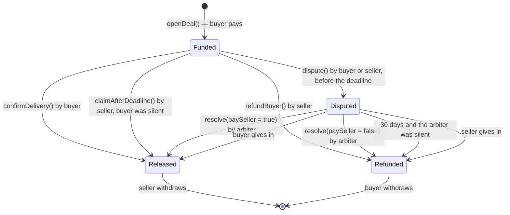

# Day 05 — Escrow

## What I built

An escrow contract: a safe middle place for money when two strangers trade online. The **buyer** pays into the contract, and the money waits there until the item arrives. If something goes wrong, a neutral **arbiter** decides who gets it, and clear deadlines make sure the money can **never get stuck**.

## How it works

1. `openDeal(seller, arbiter, duration)`: the buyer sends the payment and names the seller and a neutral arbiter (three different addresses). The deal gets an id (0, 1, 2…) and a deadline 1 to 180 days away.
2. Then **exactly one** of these closes the deal:
   - the buyer calls `confirmDelivery(id)` → the seller is paid;
   - the seller calls `refundBuyer(id)` → the buyer gets the money back;
   - before the deadline, buyer or seller calls `dispute(id)`; then **only** the arbiter can `resolve(id, paySeller)`;
   - the buyer stays silent past the deadline → the seller calls `claimAfterDeadline(id)`;
   - the arbiter stays silent for 30 days after a dispute → `refundAfterArbiterTimeout(id)` returns the money to the buyer.
3. Closing a deal only **credits** the winner. Each person then calls `withdraw()` to take out what they are owed.



Think of buying a thangka painting from a shop in Bhaktapur while you live in Pokhara. You do not want to pay before it arrives; the shop does not want to post it before you pay. So you both trust a respected neighbour: you give her the money, she holds it, and she hands it to the shop when you say the painting arrived. If you argue, she decides. If you never answer, the shop gets paid after the agreed date. And if she goes on a long trek and never decides, the money comes back to you.

**Limits:** the arbiter is trusted to decide fairly (but can never take the money), and a silent arbiter returns the money to the buyer. See [QA.md](QA.md) for why.

## Run it yourself

```bash
git clone https://github.com/Khadka1996/30-Days-of-Building-Blockchain.git
cd 30-Days-of-Building-Blockchain/day-05
npm install --legacy-peer-deps
npm test          # 29 tests, including attack tests and 60 random fuzz runs
npm run demo      # four deals, four endings: delivery, dispute, silent buyer, silent arbiter (prints gas)
npm run lint      # solhint
npm run slither   # needs: pip install slither-analyzer
```

## Results from my run

```
29 passing (5s)

Escrow deployed at 0x5FbDB2315678afecb367f032d93F642f64180aa3
Sita opens #0: thangka painting, 2 ETH         gas used: 138821
Ram (seller) releases #0 to himself:           reverted with NotBuyer
Maya (arbiter) releases #0, no dispute:        reverted with WrongState
Sita confirms delivery of #0                   gas used: 58817
Sita confirms #0 again:                        reverted with WrongState
Sita opens #1: pashmina shawl, 1 ETH           gas used: 121721
Sita disputes #1 (wrong colour)                gas used: 36388
Eve (stranger) resolves #1:                    reverted with NotArbiter
Maya resolves #1: refund the buyer             gas used: 59082
Sita opens #2: singing bowl, 0.5 ETH           gas used: 121721
Sita opens #3: khukuri knife, 1.5 ETH          gas used: 121721
Ram disputes #3 (buyer says not received)      gas used: 36555
Ram claims #2 before the deadline:             reverted with DeadlineNotPassed
--- 14 days later: deadline passed, Sita never answered on #2 ---
Sita disputes #2 after the deadline:           reverted with DeadlinePassed
Ram claims #2 after the deadline               gas used: 41875
--- 30 days after the #3 dispute: Maya never decided ---
Sita takes #3 back (arbiter timeout)           gas used: 42046
Ram is owed:                                   2.5 ETH (#0 + #2)
Sita is owed:                                  2.5 ETH (#1 + #3)
Maya is owed:                                  0.0 ETH (an arbiter never gets the money)
Ram withdraws                                  gas used: 46206
Sita withdraws                                 gas used: 46206
Ram withdraws again:                           reverted with NothingToWithdraw
Contract balance at the end:                   0.0 ETH (owes nobody anything)
```

solhint: 0 warnings · npm audit: 0 vulnerabilities · slither: 0 results · mutation check: 6 planted bugs, 6 caught

All four ways a deal can end were reached, and the wrong person was stopped every time it tried to move the money.

## What I learned

- **Every way in needs a way out.** An escrow is safe only if *every* state has an exit that does not depend on one person: a deadline for a silent buyer, a timeout for a silent arbiter. Otherwise the money gets stuck.
- **A state machine stops double payouts.** Each deal only moves forward (`Funded → Disputed → Released / Refunded`), and a closed deal can never move again, so the same money can never be paid twice.
- **One job per role.** Only the buyer releases, only the seller refunds, only the arbiter resolves and only after a dispute. The arbiter decides but never receives the money.

## Security notes

Ten findings from the review (five high, three medium), all fixed and each proven with a test, plus five known design limits: see **[QA.md](QA.md)**.

## References

- [Solidity docs — Safe remote purchase (an escrow example)](https://docs.soliditylang.org/en/v0.8.24/solidity-by-example.html#safe-remote-purchase)
- [Solidity docs — Withdrawal from contracts (pull payments)](https://docs.soliditylang.org/en/v0.8.24/common-patterns.html#withdrawal-from-contracts)
- [Solidity docs — State machine pattern](https://docs.soliditylang.org/en/v0.8.24/common-patterns.html#state-machine)
- [OpenZeppelin — Escrow and ConditionalEscrow](https://docs.openzeppelin.com/contracts/4.x/api/utils#Escrow)
- [ethereum.org — Smart contract security](https://ethereum.org/en/developers/docs/smart-contracts/security/)

## Next

**Day 06 — Crowdfunding** ([already built](../day-06)): set a goal and a deadline; the creator claims if it is met, and every backer is refunded if not.
