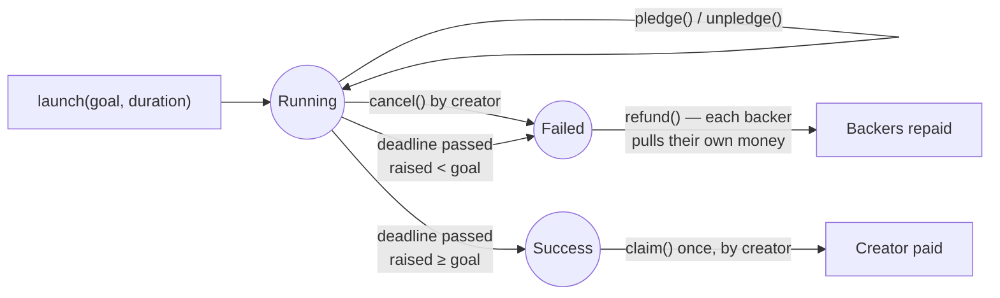

# Day 06 — Crowdfunding

## What I built

A crowdfunding contract, like a small Kickstarter on the blockchain. Anyone can start a campaign with a **goal** and a **deadline**. If the goal is reached by the deadline, the creator takes the money **once**; if not, **every backer takes their own money back**.

## How it works

1. `launch(goal, duration)`: start a campaign (1 hour to 90 days). It gets an id: 0, 1, 2…
2. `pledge(id)`: send ETH to a running campaign. `unpledge(id, amount)` takes some back before the deadline.
3. After the deadline there is **one rule**:
   - raised ≥ goal → only the creator can `claim(id)`, and only once;
   - raised < goal → each backer calls `refund(id)` for their own pledge.
4. `cancel(id)`: the creator can stop a campaign before its deadline; refunds open at once.



Think of a school collecting money for a new library in a glass box. If the box reaches Rs 10 lakh by Dashain, the headteacher takes it once and the box is sealed. If not, each parent comes and takes back exactly the envelope with their name on it. Nobody has to walk door to door returning envelopes, so one parent who is not home cannot stop everyone else from getting their money back.

**Limits:** a backer can take money back until the last second; a backer that cannot receive ETH only blocks its own refund. See [QA.md](QA.md) for why.

## Run it yourself

```bash
git clone https://github.com/Khadka1996/30-Days-of-Building-Blockchain.git
cd 30-Days-of-Building-Blockchain/day-06
npm install --legacy-peer-deps
npm test          # 27 tests, including attack tests and 50 random fuzz runs
npm run demo      # one campaign succeeds, one fails: claim once, pull refunds (prints gas)
npm run lint      # solhint
npm run slither   # needs: pip install slither-analyzer
```

## Results from my run

```
27 passing (5s)

CrowdFund deployed at 0x5FbDB2315678afecb367f032d93F642f64180aa3
Maya launches #0: library, goal 10 ETH     gas used: 94846
Maya launches #1: water tank, goal 20 ETH  gas used: 77758
Ram pledges 6 ETH to #0                    gas used: 73021
Sita pledges 5 ETH to #0                   gas used: 55921
Hari pledges 4 ETH to #1                   gas used: 73033
Ram pledges 3 ETH to #1                    gas used: 55933
Ram takes 1 ETH back from #1 (unpledge)    gas used: 55356
Maya claims #0 before the deadline:        reverted with CampaignNotEnded
Hari refunds #1 before the deadline:       reverted with CampaignNotEnded
--- 7 days later: deadlines passed ---
#0 raised:                                 11.0 of 10.0 ETH -> success
#1 raised:                                 6.0 of 20.0 ETH -> failed
Pledge to #0 after the deadline:           reverted with CampaignEnded
Maya claims #0                             gas used: 52637
Maya received:                             11.0 ETH
Maya claims #0 again:                      reverted with AlreadyClaimed
Maya claims failed #1:                     reverted with GoalNotReached
Ram asks a refund from successful #0:      reverted with GoalReached
Hari pulls his refund from #1 (4 ETH)      gas used: 56604
Ram pulls his refund from #1 (2 ETH)       gas used: 56604
Hari refunds #1 again:                     reverted with NothingToRefund
Contract balance at the end:               0.0 ETH (owes nobody anything)
```

solhint: 0 warnings · npm audit: 0 vulnerabilities · slither: 0 results

Every refund costs the same gas (56,604 for Hari and for Ram), and the tests show the same with 40 backers: a pull refund never gets more expensive as a campaign grows.

## What I learned

- **Don't loop over people to pay them; let them pull.** One backer that refuses ETH would break a refund loop for everyone. With pull payments, each person can only ever block themselves.
- **Write it down before you pay it out.** Setting `claimed = true` and zeroing a pledge *before* sending ETH is what makes claiming twice or refunding twice impossible, even from a contract that calls back in.
- **Never trust `address(this).balance`.** Many campaigns share one contract, and anyone can force ETH in. Each campaign keeps its own counter, and every decision uses only that counter.

## Security notes

Ten findings from the review (four high, three medium), all fixed and each proven with a test, plus four known design limits: see **[QA.md](QA.md)**.

## References

- [Solidity docs — Withdrawal from contracts (pull payments)](https://docs.soliditylang.org/en/v0.8.24/common-patterns.html#withdrawal-from-contracts)
- [Solidity by Example — Crowd Fund](https://solidity-by-example.org/app/crowd-fund/)
- [Consensys — Smart contract best practices: denial of service](https://consensys.github.io/smart-contract-best-practices/attacks/denial-of-service/)
- [OpenZeppelin — PullPayment / Escrow](https://docs.openzeppelin.com/contracts/4.x/api/security#PullPayment)
- [ethereum.org — Smart contract security](https://ethereum.org/en/developers/docs/smart-contracts/security/)

## Next

**Day 07 — Week 1 recap + deploy kit:** review all of Week 1 and get a deploy script and Etherscan verification ready for the Sepolia test network.
