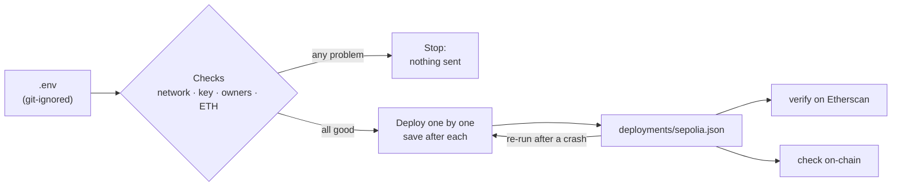

# Day 07 — Week 1 recap + deploy kit

## What I built

A **deploy kit** that takes all six Week 1 contracts (to-do list, piggy bank, voting, multisig, escrow, crowdfunding) from my laptop to the **Sepolia test network** and verifies them on Etherscan. It checks everything that can go wrong **before** spending any ETH, saves every address as it goes, and can safely be run again after a crash. I also reviewed the whole week's code together.

## How it works

1. `npm run deploy:sepolia` reads the settings from `.env` (never committed).
2. **Before sending anything**, it checks: the network is Sepolia or the local chain (never mainnet), the private key looks right, the multisig owners and threshold are valid, and the wallet has enough ETH for **all six** contracts.
3. It deploys the contracts one by one and writes each address to `deployments/sepolia.json` straight away.
4. Run it again after an error: contracts already on-chain are skipped, so nothing is paid twice.
5. `npm run verify:sepolia` publishes the source code on Etherscan using the saved constructor arguments; `npm run check:sepolia` confirms every contract is there and the multisig has the right owners.



Think of moving house. Before the truck comes, you check the new address is right, the keys are in your pocket (not taped to the door), and you have enough money for the whole move. You tick each box off a list as it goes in, so if the truck breaks down half-way, the next truck only carries what is left.

**Step-by-step guide for Sepolia:** [DEPLOY.md](DEPLOY.md)

## Run it yourself

```bash
git clone https://github.com/Khadka1996/30-Days-of-Building-Blockchain.git
cd 30-Days-of-Building-Blockchain/day-07
npm install --legacy-peer-deps
npm test          # 21 tests, including 40 random fuzz runs
npm run demo      # full rehearsal on the local chain: refusals, deploy, resume, check
npm run lint      # solhint
npm run slither   # needs: pip install slither-analyzer
```

To deploy for real on Sepolia, follow [DEPLOY.md](DEPLOY.md).

## Results from my run

```
21 passing (3s)

1) Safety checks before any gas is spent
Deploy to Ethereum mainnet (chain 1):       refused: Refusing to deploy to chain 1
Owner listed twice:                         refused: Owner 0x70997970C51812dc3A010C7d01b50e0d17dc79C8 is listed twice.
Threshold 4 with 3 owners:                  refused: Threshold must be a whole number from 1 to 3, got 4.
Wallet with 0.0001 ETH:                     refused: Not enough ETH: need about 0.027640624 ETH, the deployer has 0.0001 ETH
Transactions sent by that wallet:           0

2) Deploy all six Week 1 contracts
Network: hardhat (local) · deployer 0xf39Fd6e51aad88F6F4ce6aB8827279cffFb92266
Balance: 9999.999860625 ETH · 6 to deploy · estimated 10051136 gas ≈ 0.027640624 ETH
  TodoList        0xe7f1725E7734CE288F8367e1Bb143E90bb3F0512  gas used: 1470863
  PiggyBank       0x9fE46736679d2D9a65F0992F2272dE9f3c7fa6e0  gas used: 884385
  Voting          0xCf7Ed3AccA5a467e9e704C703E8D87F634fB0Fc9  gas used: 1880443
  MultiSigWallet  0xDc64a140Aa3E981100a9becA4E685f962f0cF6C9  gas used: 2563147
  Escrow          0x5FC8d32690cc91D4c39d9d3abcBD16989F875707  gas used: 1801972
  CrowdFund       0x0165878A594ca255338adfa4d48449f69242Eb8F  gas used: 1450326
Total gas for six contracts:                10051136
At 2 gwei on Sepolia that costs about:      0.020102272 ETH

3) Run it again (as after a failed run): nothing is paid twice
  TodoList        already deployed at 0xe7f1725E7734CE288F8367e1Bb143E90bb3F0512 (skipped)
  PiggyBank       already deployed at 0x9fE46736679d2D9a65F0992F2272dE9f3c7fa6e0 (skipped)
  Voting          already deployed at 0xCf7Ed3AccA5a467e9e704C703E8D87F634fB0Fc9 (skipped)
  MultiSigWallet  already deployed at 0xDc64a140Aa3E981100a9becA4E685f962f0cF6C9 (skipped)
  Escrow          already deployed at 0x5FC8d32690cc91D4c39d9d3abcBD16989F875707 (skipped)
  CrowdFund       already deployed at 0x0165878A594ca255338adfa4d48449f69242Eb8F (skipped)
Network: hardhat (local) · deployer 0xf39Fd6e51aad88F6F4ce6aB8827279cffFb92266
Balance: 9999.984105921342510562 ETH · 0 to deploy · estimated 0 gas ≈ 0.0 ETH
New transactions on the second run:         0
Resume with different multisig owners:      refused: MultiSigWallet at 0xDc64a140Aa3E981100a9becA4E685f962f0cF6C9 was deployed with different settings

4) Post-deploy check
Problems found:                             none

5) Etherscan verification commands this record produces
  npx hardhat verify --network sepolia 0xe7f1725E7734CE288F8367e1Bb143E90bb3F0512
  npx hardhat verify --network sepolia 0x9fE46736679d2D9a65F0992F2272dE9f3c7fa6e0
  npx hardhat verify --network sepolia 0xCf7Ed3AccA5a467e9e704C703E8D87F634fB0Fc9
  npx hardhat verify --network sepolia --constructor-args deployments/sepolia.MultiSigWallet.args.js 0xDc64a140Aa3E981100a9becA4E685f962f0cF6C9
  npx hardhat verify --network sepolia 0x5FC8d32690cc91D4c39d9d3abcBD16989F875707
  npx hardhat verify --network sepolia 0x0165878A594ca255338adfa4d48449f69242Eb8F
```

solhint: 0 problems · npm audit: 0 vulnerabilities · slither: 1 result (accepted, see QA.md W-02)

The gas estimate made before deploying (10,051,136) matched the gas actually used exactly. The wallet with too little ETH sent **0** transactions, and the second run sent **0** new transactions.

## Week 1 recap

| Day | Project | The one lesson |
|----:|---------|----------------|
| [01](../day-01) | To-do list | Store data under `msg.sender`, and only the owner can change it |
| [02](../day-02) | Piggy bank with a time lock | Checks → effects → interaction: update the balance before sending ETH |
| [03](../day-03) | Voting app | One vote per address and a hard deadline, both enforced on-chain |
| [04](../day-04) | Multisig wallet | Old proposals must die when the owners change (replay safety) |
| [05](../day-05) | Escrow | A state machine that only moves forward, with timeouts so money never gets stuck |
| [06](../day-06) | Crowdfunding | Never loop over people to pay them: let each person pull their own money |

## What I learned

- **Most losses happen around the code, not in it.** A private key pushed to GitHub or a script pointed at the wrong network can lose money even when every contract is perfect. So the kit refuses mainnet and keeps the key in a git-ignored `.env`, and tests prove both.
- **Check before you pay.** Validating the multisig settings in JavaScript costs nothing; a fuzz test proves the JavaScript check accepts and rejects exactly what the real contract constructor does.
- **Deploy scripts must be safe to run twice.** Saving each address the moment it is deployed turns "it crashed half-way" from a lost afternoon (and lost ETH) into "just run it again".

## Security notes

Nine deploy-kit findings (two high, five medium) and four week-wide notes, all fixed or explained, each proven with a test where possible, plus three known limits: see **[QA.md](QA.md)**.

## References

- [Hardhat — Deploying and verifying contracts](https://hardhat.org/hardhat-runner/docs/guides/deploying)
- [Hardhat — hardhat-verify plugin](https://hardhat.org/hardhat-runner/plugins/nomicfoundation-hardhat-verify)
- [ethereum.org — Deploying smart contracts](https://ethereum.org/en/developers/docs/smart-contracts/deploying/)
- [Etherscan — Verifying contracts](https://docs.etherscan.io/contract-verification/verify-with-hardhat)
- [GitHub Docs — Removing sensitive data from a repository](https://docs.github.com/en/authentication/keeping-your-account-and-data-secure/removing-sensitive-data-from-a-repository)

## Next

**Day 08 — My own token + faucet:** an ERC-20 token and a faucet that gives a little to each address once a day.
