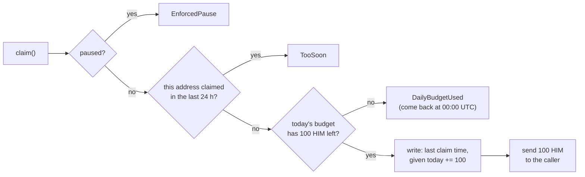

# Day 08 — My own token + faucet

## What I built

My own token, **Himal Token (HIM)**, and a **faucet** that gives a little of it to anyone who asks: **100 HIM, once every 24 hours per address**. The token has a fixed supply of 1,000,000 HIM created once at deploy, with no way to ever make more. The faucet also has a **daily budget** (1,000 HIM a day for everyone together), so one person with thousands of addresses can never empty it.

## How it works

1. `HimalToken`: a plain OpenZeppelin ERC-20. All 1,000,000 HIM go to the deployer at deploy. There is **no mint function**.
2. The owner deploys `Faucet(token, 100 HIM, 1,000 HIM)` and sends it tokens with a normal `transfer`.
3. `claim()`: anyone gets 100 HIM if **both** limits allow it:
   - their own address has not claimed in the last 24 hours (`TooSoon` otherwise);
   - today's budget (UTC day) still has room (`DailyBudgetUsed` otherwise, with the time tomorrow starts).
4. The owner can `setLimits`, `pause` / `unpause` during an attack, and `withdraw` leftover tokens. Ownership moves in two steps (the new owner must accept).



Think of free tea at a temple in Kathmandu. The rule "one cup per person per day" sounds fair, but a person can come back in a new hat again and again; on a blockchain a new address is a new hat, and it costs nothing. So the temple also makes **only 10 pots a day**. When the pots are empty, everyone comes back tomorrow. Someone in many hats can take today's tea, but never the whole store of tea leaves.

## Run it yourself

```bash
git clone https://github.com/Khadka1996/30-Days-of-Building-Blockchain.git
cd 30-Days-of-Building-Blockchain/day-08
npm install --legacy-peer-deps
npm test          # 23 tests, including a 50-address attack and 100 random fuzz runs
npm run demo      # two users claim, then one attacker tries 50 new addresses (prints gas)
npm run lint      # solhint
npm run slither   # needs: pip install slither-analyzer
```

## Results from my run

```
23 passing (5s)


HimalToken (HIM) deployed at                   0x5FbDB2315678afecb367f032d93F642f64180aa3
Total supply (fixed, no mint function)         1,000,000 HIM
Faucet deployed at                             0xe7f1725E7734CE288F8367e1Bb143E90bb3F0512
Rules                                          100 HIM per claim, 24 h wait, 1,000 HIM per day
Owner puts 100,000 HIM in the faucet           gas used: 52234
Ram claims                                     gas used: 133740
Sita claims                                    gas used: 96750
Ram's balance                                  100 HIM
Ram claims again right away:                   reverted with TooSoon
Ram must wait                                  24.0 hours
Left in today's budget                         800 HIM
--- attack: one person, 50 brand-new addresses, one transaction ---
Eve's 50-address attack                        gas used: 2470181
Addresses that got tokens                      8 of 50
Eve received                                   800 HIM (not 5,000)
Faucet still holds                             99,000 HIM
A new user claims today:                       reverted with DailyBudgetUsed
--- 24 hours later ---
Left in today's budget                         1,000 HIM
Ram claims again                               gas used: 65538
Ram's balance                                  200 HIM
```

solhint: 0 warnings · npm audit: 0 vulnerabilities · slither: 0 results

The attack made **50 brand-new addresses** in one transaction. Only **8 got tokens** (the 800 HIM left in that day's budget); the other 42 were refused, and the faucet kept 99,000 of its 100,000 HIM.

## What I learned

- **An address is not a person.** Making a new address is free, so "once per address" alone is no limit at all. A **global daily budget** is what caps the damage: the worst case is one day's budget per day, never the whole faucet.
- **"Once a day" needs a precise meaning.** If "a day" means the calendar day, someone can claim at 23:59 and again at 00:01. The per-address rule is a rolling **24 hours**; only the shared budget resets at 00:00 UTC.
- **Less power is safer.** The token has no mint function and no owner, so there is nothing to steal or misuse. The faucet's owner can only pause, change limits within safe bounds, and withdraw.

## Security notes

Eight findings from the review (one high, four medium), all fixed and each proven with a test, plus three known design limits: see **[QA.md](QA.md)**.

## References

- [OpenZeppelin Contracts — ERC-20](https://docs.openzeppelin.com/contracts/5.x/erc20)
- [EIP-20: Token Standard](https://eips.ethereum.org/EIPS/eip-20)
- [OpenZeppelin — SafeERC20](https://docs.openzeppelin.com/contracts/5.x/api/token/erc20#SafeERC20)
- [OpenZeppelin — Pausable and Ownable2Step](https://docs.openzeppelin.com/contracts/5.x/api/utils#Pausable)
- [Solidity docs — Security considerations](https://docs.soliditylang.org/en/v0.8.24/security-considerations.html)

## Next

**Day 09 — Token vesting:** team tokens that unlock slowly over 12 months, with a cliff.
