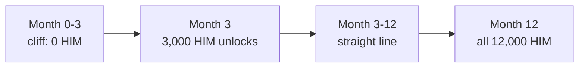

# Day 09 — Token vesting

## What I built

A **vesting contract**: team tokens are locked and unlock slowly over **12 months, with nothing at all for the first 3 months (the cliff)**. If someone leaves early, the owner can stop the part they have not earned yet, but can never touch what they already earned. It uses the Himal Token (HIM) from Day 08.

## How it works

1. The owner sends tokens to `TokenVesting`, then calls `createSchedule` for each person. It refuses to promise tokens that are not already there.
2. Before the cliff (month 3): nothing can be claimed.
3. At the cliff and after: the unlocked amount follows a straight line, `total × time passed ÷ duration`. At month 3 that is 3/12, at month 6 it is 6/12.
4. `release()`: pays you everything vested so far minus everything already paid.
5. `revoke()` (only for schedules created as revocable): freezes the schedule at what has vested. The rest becomes spare tokens that the owner can withdraw.



Think of a salary paid into a locked box. The box opens only after 3 months of work, then one month of salary becomes yours each month you stay. If you leave, you keep what you already earned, and the company keeps the rest.

## Run it yourself

```bash
git clone https://github.com/Khadka1996/30-Days-of-Building-Blockchain.git
cd 30-Days-of-Building-Blockchain/day-09
npm install --legacy-peer-deps
npm test          # 28 tests, including 365 daily claims and 100 random fuzz runs
npm run demo      # 12 months of vesting, an early claim, a revoke (prints gas)
npm run lint      # solhint
npm run slither   # needs: pip install slither-analyzer
```

## Results from my run

```
28 passing

Schedule                                       12,000 HIM, 12 months, 3-month cliff
Create a schedule                              gas used: 105893

Month   Unlocked (HIM)
0       0
1       0
2       0
3       3,000
6       6,000
9       9,000
12      12,000

Ram claims 1 second before the cliff:          reverted with NothingToRelease
Ram claims at the cliff (month 3)              gas used: 73409
Ram's balance                                  3,000 HIM
Sita leaves at month 6; owner revokes          gas used: 44825
Sita can still claim                           6,000 HIM (what she earned)
Returned to spare tokens                       6,000 HIM
Ram's final balance (month 12)                 12,000 HIM
Sita's final balance                           6,000 HIM
Still owed by the contract                     0 HIM

--- rounding: 1,000 wei claimed daily for 365 days ---
This contract pays                             1000 wei
Naive 'time since last claim' maths pays       730 wei
```

solhint: 0 warnings · npm audit: 0 vulnerabilities · slither: 0 results · mutation check: 8 of 8 broken versions caught

## What I learned

- **Rounding adds up when you round every time.** Paying "for the time since the last claim" loses a little on each claim: 270 of 1,000 wei in a year. Working from the running total ("vested so far minus paid so far") loses nothing, however often you claim.
- **Multiply first, divide last.** In Solidity `7 / 10 * 100` is 0, but `7 * 100 / 10` is 70: dividing first throws away digits you can never get back. Then make sure the multiplication cannot overflow.
- **A promise needs an accounting line.** `totalOwed` is what lets the owner withdraw spare tokens while making promised tokens impossible to touch.

## Security notes

Nine findings from the review (three high, four medium), all fixed and each proven with a test, plus the known design limits: see **[QA.md](QA.md)**.

## References

- [OpenZeppelin — VestingWallet](https://docs.openzeppelin.com/contracts/5.x/api/finance#VestingWallet)
- [OpenZeppelin — SafeERC20](https://docs.openzeppelin.com/contracts/5.x/api/token/erc20#SafeERC20)
- [Solidity docs — Integer division](https://docs.soliditylang.org/en/v0.8.24/types.html#division)
- [Solidity docs — Security considerations](https://docs.soliditylang.org/en/v0.8.24/security-considerations.html)
- [SWC-116: Block values as a proxy for time](https://swcregistry.io/docs/SWC-116)

## Next

**Day 10 — Airdrop with Merkle proofs:** 1,000 addresses can claim, with only one hash stored on-chain.
