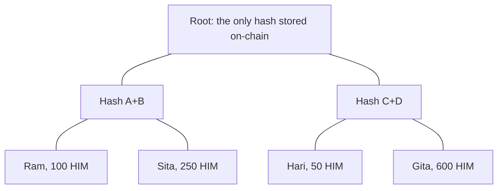

# Day 10 — Airdrop with Merkle proofs

## What I built

An **airdrop contract** where 1,000 addresses can each claim their tokens, while the contract stores only **one hash** (the Merkle root). Each person proves they are on the list with about 10 hashes that they send themselves when they claim. It pays out the Himal Token (HIM) from Day 08.

## How it works

1. Off-chain, `lib/airdrop.js` checks the list (no duplicates, no bad addresses, no zero amounts) and builds a Merkle tree. The top hash is the root.
2. The contract is deployed with that root. The root can never change.
3. The treasury calls `fund()`, which deposits the full total and starts the claim window (for example 30 days).
4. To claim, you send your position on the list, your amount and your proof. The contract rebuilds your line using **your own wallet address** and walks up to the root. If it matches, you get paid and your position is marked as claimed.
5. After the deadline, `sweep()` sends what is left back to the treasury. There is no owner, so nobody can take the tokens early.



Sita's proof is two hashes: Ram's leaf and "Hash C+D". With those, the contract can work its way up to the root. Changing even one digit of her amount gives a different root, and the claim fails.

Think of a sealed list kept at a bank. The bank only keeps a fingerprint of the list. You bring your line and a few matching pieces, and the fingerprint proves your line is genuine.

## Run it yourself

```bash
git clone https://github.com/Khadka1996/30-Days-of-Building-Blockchain.git
cd 30-Days-of-Building-Blockchain/day-10
npm install --legacy-peer-deps
npm test          # 28 tests, including 1,000 real claims and 100 random fuzz runs
npm run demo      # 1,000 addresses, real claims, cheating attempts, gas comparison
npm run lint      # solhint
npm run slither   # needs: pip install slither-analyzer
```

## Results from my run

```
28 passing

Addresses on the list                          1,000
Total airdrop                                  100000.0 HIM
Stored on-chain                                1 hash: 0x3349037066095d786b6d2f330da7646c39e33d39c922312791308453cf21200a
Hashes in a proof                              8 to 10
Deploy the airdrop (any list size)             gas used: 1275668
Average claim (first 100 people)               gas used: 82093
Wallet 0 balance                               100.0 HIM

--- trying to cheat ---
Claim a second time                            reverted with AlreadyClaimed
Copy someone else's proof                      reverted with InvalidProof
Ask for 1 wei more                             reverted with InvalidProof
Sweep before the deadline                      reverted with ClaimsStillOpen

--- the expensive way: store all 1,000 on-chain ---
Store every address                            gas used: 23586810
Merkle airdrop setup                           gas used: 1275668
Setup is cheaper by                            18.5 times

Left in contract after the sweep              0.0 HIM
```

solhint: 0 warnings · npm audit: 0 vulnerabilities · slither: 0 results · mutation check: 14 of 14 broken versions caught

The gas saving is for setup. Merkle moves the cost to the people claiming: about 82,000 gas each, paid only by those who actually claim.

## What I learned

- **A proof must be tied to the caller.** The contract builds the leaf from `msg.sender`, so a proof copied from the waiting transactions is useless to anyone else.
- **Hash the leaf twice.** An inner node of the tree is also a hash of 64 bytes. Double hashing the leaf means an inner node can never be passed off as a real entry.
- **A bitmap makes "already claimed" cheap.** One storage slot records 256 claims, instead of one slot per person.

## Security notes

Nine findings from the review (three high, four medium, two low), all fixed and each proven with a test, plus the known design limits: see **[QA.md](QA.md)**.

## References

- [OpenZeppelin — MerkleProof](https://docs.openzeppelin.com/contracts/5.x/api/utils#MerkleProof)
- [OpenZeppelin — BitMaps](https://docs.openzeppelin.com/contracts/5.x/api/utils#BitMaps)
- [OpenZeppelin — merkle-tree (double-hashed leaves)](https://github.com/OpenZeppelin/merkle-tree#leaf-hash)
- [Ethereum.org — Merkle proofs for offline data integrity](https://ethereum.org/en/developers/tutorials/merkle-proofs-for-offline-data-integrity/)
- [Solidity docs — Security considerations](https://docs.soliditylang.org/en/v0.8.24/security-considerations.html)

## Next

**Day 11 — NFT collection:** mint with an allowlist, a public sale and a max supply.
