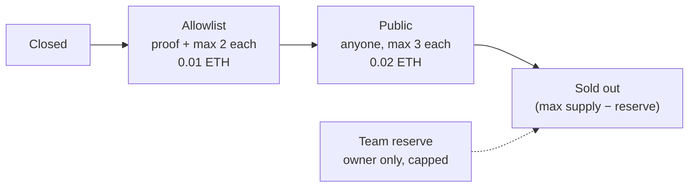

# Day 11 — NFT collection

## What I built

**Himal Peaks (PEAK)**, an ERC-721 NFT collection with a hard **max supply**. It sells in two phases: an **allowlist sale** for listed wallets at a lower price, then a **public sale** for everyone. Each wallet has a limit, a small **team reserve** is kept aside, and no combination of sales can ever mint more than the max supply.

## How it works

1. The owner deploys with the max supply, the team reserve, two prices, a fixed treasury and the **allowlist root** (one hash for the whole list, built with the Merkle tree method from Day 10).
2. The owner moves the sale through phases: **Closed → Allowlist → Public**.
3. **Allowlist phase:** a listed wallet sends its proof and mints up to **2** at 0.01 ETH. The proof is checked against the caller's own address, so a copied proof is useless.
4. **Public phase:** anyone mints up to **3** per wallet at 0.02 ETH. Payment must be exact.
5. The sale stops when `maxSupply − teamReserve` are sold. The owner can then mint the reserve, and never more.
6. `withdraw()` sends the money to the fixed treasury only. `freezeMetadata()` locks the art link for ever.



Think of a concert: early tickets for the fan club (the allowlist), then general sale, a limit per person at the door, a few seats kept for the crew, and a hall that can never hold more than its capacity.

## Run it yourself

```bash
git clone https://github.com/Khadka1996/30-Days-of-Building-Blockchain.git
cd 30-Days-of-Building-Blockchain/day-11
npm install --legacy-peer-deps
npm test          # 31 tests, including 300 real allowlist mints and 100 random fuzz runs
npm run demo      # a 100-token collection sells out, every cheat fails
npm run lint      # solhint
npm run slither   # needs: pip install slither-analyzer
```

## Results from my run

```
Collection                                     Himal Peaks (PEAK), max supply 100
Team reserve                                   10 tokens, kept aside from the sale
Allowlist                                      30 wallets, 1 hash on-chain
Allowlist sale                                 60 minted, 2 each at 0.01 ETH
Average allowlist mint of 2                    gas used: 139269

--- trying to cheat in the allowlist sale ---
Wallet not on the list                         reverted with NotOnAllowlist
Listed wallet asks for a 3rd                   reverted with WalletLimit
Public mint before the public sale             reverted with WrongPhase

Public sale                                    90 minted in total, sale left: 0
Average public mint of 3                       gas used: 158922

--- trying to cheat in the public sale ---
Ask for 4 in one wallet                        reverted with WalletLimit
Pay 1 wei too much                             reverted with WrongPayment
Mint after the sale sold out                   reverted with SoldOut

Team mint                                      10 tokens, total now 100 / 100
Team asks for 1 more                           reverted with ReserveExceeded
Token 100 metadata                             ipfs://bafy-himal-peaks/100.json

Raised                                         1.2 ETH (60 x 0.01 + 30 x 0.02)
Stranger tries withdraw()                      reverted with OwnableUnauthorizedAccount
Treasury received                              1.2 ETH
```

31 passing · solhint: 0 warnings · npm audit: 0 vulnerabilities · slither: 0 results · mutation check: 17 of 18 broken versions caught (the one left is a backstop check that no normal path can reach, see [QA.md](QA.md))

## What I learned

- **Save the counter before you mint.** `_safeMint` calls into the receiver's code. If the limit is saved after the mint, a bot contract can call back in and mint again. Here every limit is saved first, and every mint function is `nonReentrant`.
- **The reserve must come off the sale, not the end.** If the public sale can sell the whole supply, the team reserve can be "promised" but never minted. `saleRemaining()` always keeps the unminted reserve aside.
- **Per-wallet limits slow bots, they don't stop them.** One person can make many wallets. An allowlist is the real filter; the limits keep the sale fair for everyone else.

## Security notes

Ten findings from the review (four high, four medium, two low), all fixed and each proven with a test, plus the known design limits: see **[QA.md](QA.md)**.

## References

- [EIP-721: Non-Fungible Token Standard](https://eips.ethereum.org/EIPS/eip-721)
- [OpenZeppelin — ERC-721](https://docs.openzeppelin.com/contracts/5.x/erc721)
- [OpenZeppelin — MerkleProof](https://docs.openzeppelin.com/contracts/5.x/api/utils#MerkleProof)
- [OpenZeppelin — ReentrancyGuard](https://docs.openzeppelin.com/contracts/5.x/api/utils#ReentrancyGuard)
- [Solidity docs — Security considerations](https://docs.soliditylang.org/en/v0.8.24/security-considerations.html)

## Next

**Day 12 — NFT marketplace:** list, buy and cancel NFTs; the creator gets a royalty.
