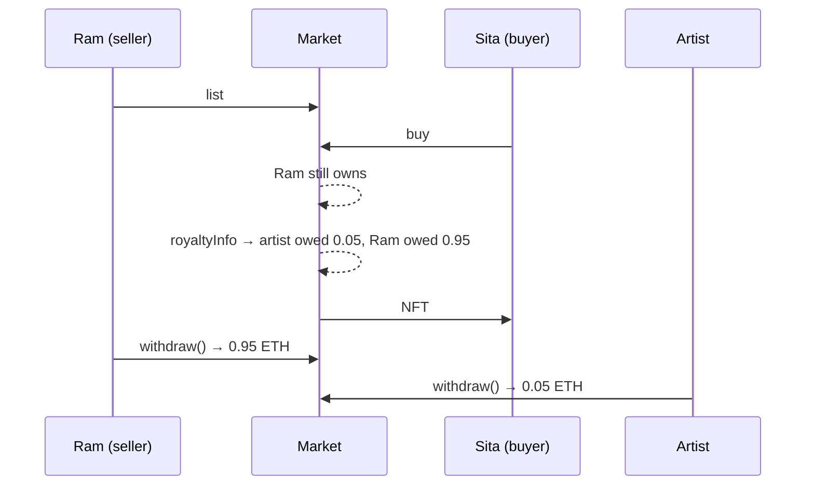

# Day 12 — NFT marketplace with creator royalties

## What I built

**Himal Market**, a small shop for NFTs. A seller lists an NFT at a fixed price, a buyer pays exactly that price, and the NFT's artist automatically gets a royalty (5% for today's collection, **Himal Prints**) on the first sale and on every resale after it.

The NFT never leaves the seller's wallet while it is listed, so the market checks again at the moment of sale that the seller still owns it. An old listing for an NFT that was sold or given away somewhere else can never be bought.

## How it works

1. The seller calls `nft.approve(market, tokenId)`, then `list(nft, tokenId, price, duration)`. The listing lasts from 1 hour to 180 days.
2. The buyer calls `buy(nft, tokenId, expectedPrice)` and sends exactly the price. Before anything moves, the market checks that the listing has not expired, the seller still owns the NFT, the market is still approved, and the price is still the one the buyer saw.
3. The market asks the NFT contract `royaltyInfo(tokenId, price)` (the **ERC-2981** standard). The artist's share and the seller's share are written down in `proceeds`. A royalty above 10% is cut down to 10%.
4. The NFT moves from the seller to the buyer. Later, the seller and the artist each call `withdraw()` to collect their money.



Think of a consignment shop where the painting stays at the owner's house until it sells. If the shop kept selling from an old list, it could sell a painting that already belongs to someone else. So at every sale the shop phones the house first: "Do you still own it?" And every time the painting is resold, a small cut goes back to the painter.

## Run it yourself

```bash
git clone https://github.com/Khadka1996/30-Days-of-Building-Blockchain.git
cd 30-Days-of-Building-Blockchain/day-12
npm install --legacy-peer-deps
npm test          # 30 tests, including attack contracts and 140 random fuzz runs
npm run demo      # list, buy, resell, a stale-listing attack and a greedy royalty
npm run lint      # solhint
npm run slither   # needs: pip install slither-analyzer
```

## Results from my run

```
30 passing

=== Himal Prints #1, artist royalty 5% ===
Ram lists #1 (NFT stays in his wallet)        1.0 ETH, gas used: 81359
Sita buys #1                                  1.0 ETH, gas used: 131194
  Ram is owed                                 0.95 ETH
  Artist is owed                              0.05 ETH
Sita resells #1 to Hari                       4.0 ETH
  Sita is owed                                3.8 ETH
  Artist is owed (both sales)                 0.25 ETH

=== Front-running: the seller raises the price while Hari waits ===
Hari's buy (expected 1 ETH)                   reverted with PriceChanged, paid nothing

=== Selling an NFT you no longer own ===
Ram gives #3 to Eve; his old listings remain
HimalMarket: Hari buys Ram's old listing      reverted with StaleListing
  isBuyable(#3)                               false
Naive market: same purchase                   Eve lost #3, owner now Hari: true

=== A collection that asks for a 100% royalty ===
Price 2 ETH, royalty asked 100%               royalty paid 0.2 ETH (capped at 10%)
  Seller gets                                 1.8 ETH

=== Withdrawals ===
Ram withdraws                                 0.95 ETH
Sita withdraws                                3.8 ETH
Artist withdraws                              0.25 ETH
Left in the market                            0.0 ETH
```

solhint: 0 warnings · npm audit: 0 vulnerabilities · slither: 0 results · mutation check: 16 of 16 broken versions caught

## What I learned

- **A listing is a promise about the past.** It was true when it was made, but the NFT can move afterwards. The naive market moved the NFT from whoever owned it now and paid whoever listed it, so Eve lost an NFT she never listed. The fix is one line: at sale time, check that the seller still owns it.
- **Don't trust another contract's numbers.** ERC-2981 lets the NFT contract say how much royalty it wants. A greedy or broken collection could ask for 100% or simply revert. The market caps royalties at 10% and treats a broken `royaltyInfo` as "no royalty".
- **Buyers need to name their price.** Without `expectedPrice`, a seller watching waiting transactions could raise the price just before a buyer's purchase lands. Now that purchase simply fails.

## Security notes

Seven findings from the review (one high, four medium, two low), all fixed and each proven with a test, plus the known design limits: see **[QA.md](QA.md)**.

## References

- [EIP-2981 — NFT Royalty Standard](https://eips.ethereum.org/EIPS/eip-2981)
- [EIP-721 — Non-Fungible Token Standard (approve, transferFrom)](https://eips.ethereum.org/EIPS/eip-721)
- [OpenZeppelin — ERC2981 and ERC721](https://docs.openzeppelin.com/contracts/5.x/api/token/common#ERC2981)
- [Solidity docs — Withdrawal from contracts](https://docs.soliditylang.org/en/v0.8.24/common-patterns.html#withdrawal-from-contracts)
- [Consensys — Front-running](https://consensys.github.io/smart-contract-best-practices/attacks/frontrunning/)

## Next

**Day 13 — Auction:** English (rising bids) and Dutch (falling price) auctions for NFTs.
