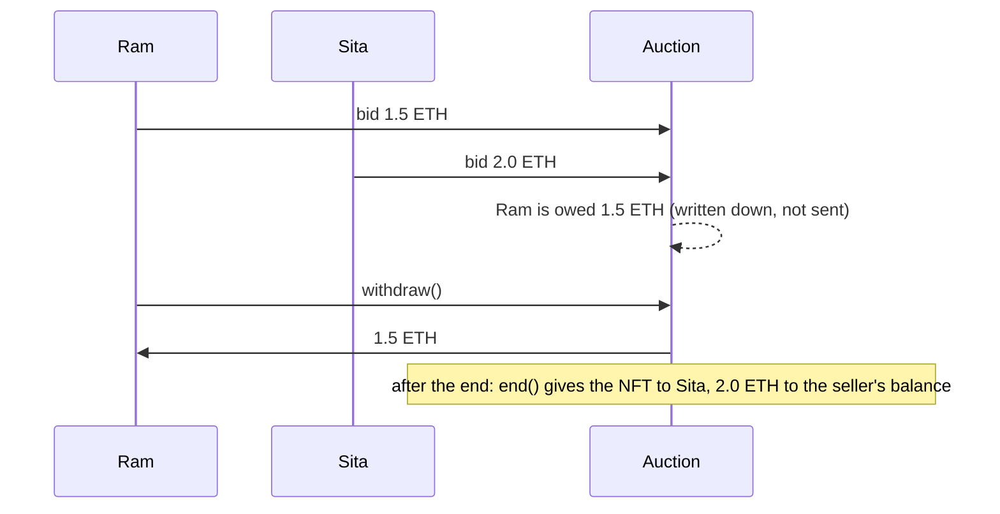

# Day 13 — Auction (English and Dutch)

## What I built

Two ways to sell an NFT on-chain. In the **English auction** the price goes up: people bid, each bid must beat the last one by at least 5%, and the highest bid wins. In the **Dutch auction** the price goes down: it starts high, falls every second, and the first person who accepts the price wins.

Both are built so that one bad bidder can never freeze the sale, and nobody can win by bidding in the very last second.

## How it works

**English auction (`EnglishAuction.sol`)**

1. The seller calls `start()`. The NFT moves into the contract and bidding is open for 24 hours (any time from 1 hour to 30 days).
2. People call `bid()` with ETH. The first bid must reach the reserve price; every next bid must be at least 5% higher.
3. When someone is outbid, their ETH is **not sent back right away**. It is written down in `pendingReturns`, and they collect it with `withdraw()`.
4. A bid in the last 10 minutes moves the end to 10 minutes after that bid, so everyone else gets time to answer.
5. After the end, anyone calls `end()`. The NFT goes to the winner, and the winning bid is written down for the seller to `withdraw()`.



**Dutch auction (`DutchAuction.sol`)**

```
price
10 ETH |\
       |  \
       |    \
       |      \
 1 ETH |        \__________  (stays at the floor)
       +----------+---------> time
       start     24 hours
```

1. The seller calls `start()`. The price falls in a straight line from 10 ETH to 1 ETH over 24 hours.
2. The buyer calls `buy()` and sends the most they are willing to pay. The contract charges the price at that second and sends the change back at once. A slow transaction can only make the price lower.
3. The seller collects the money with `withdraw()`. If nobody buys by the end of the drop, the seller can take the NFT back. They cannot cancel while the price is still falling.

Think of the English auction as a cattle market where the auctioneer waits a little longer every time a new hand goes up. The Dutch auction is a flower market clock: the price ticks down and the first person to press the button buys.

## Run it yourself

```bash
git clone https://github.com/Khadka1996/30-Days-of-Building-Blockchain.git
cd 30-Days-of-Building-Blockchain/day-13
npm install --legacy-peer-deps
npm test          # 46 tests, including attack contracts and 100 random fuzz runs
npm run demo      # both auctions, a sniper, a bad bidder and the naive auction it would freeze
npm run lint      # solhint
npm run slither   # needs: pip install slither-analyzer
```

## Results from my run

```
46 passing

=== English auction: Himal Art #1, reserve 1 ETH, 24 hours ===
Bad bidder (rejects ETH refunds) bids         1.0 ETH
Ram outbids it (still works)                  1.5 ETH, gas used: 59882
Sita tries 1.55 ETH (needs +5%)               reverted with BidTooLow
Sita bids                                     2.0 ETH
Hari snipes 30 s before the end               2.1 ETH, end moved +570 s
Sita answers 5 minutes later                  3.0 ETH
Winner                                        Sita, for 3.0 ETH
Bad bidder's withdraw                         reverted with TransferFailed
  (only hurts itself, still owed)             1.0 ETH
Seller, Ram, Sita and Hari withdraw           done
Left in contract (bad bidder's 1 ETH)         1.0 ETH

=== The naive auction that pays refunds immediately ===
Bad bidder bids 1 ETH, then Ram bids 5 ETH    reverted with "refund failed"
Result                                        auction frozen, bad bidder wins with 1 ETH

=== Dutch auction: Himal Art #2, 10 ETH falling to 1 ETH over 24 hours ===
Price at the start                            10.0 ETH
Price after 6 hours                           7.75 ETH
Price after 12 hours                          5.5 ETH
Price after 18 hours                          3.25 ETH
Seller tries to cancel in front of a buyer    reverted with PriceStillFalling
Ram buys at 20 hours, sends 5 ETH             pays 2.5 ETH, change back, gas used: 139949
Sita tries to buy too                         reverted with AuctionClosed
Seller withdraws                              2.5 ETH
Left in contract                              0.0 ETH
```

solhint: 0 warnings · npm audit: 0 vulnerabilities · slither: 0 results · mutation check: 18 of 18 broken versions caught

## What I learned

- **Never send refunds inside `bid()`.** If paying the last bidder back can fail, one wallet that rejects ETH freezes the whole auction. Writing the amount down and letting people withdraw keeps every bad wallet's problem its own.
- **Front-running is not only for bots.** In an auction it can be a sniper in the last second, or the seller cancelling just before a buyer's cheap purchase. Each one needed its own rule: the 10-minute extension, and no cancelling while the price is still falling.
- **`safeTransferFrom` can be a trap at settlement.** It calls the winner's contract, and that contract can refuse. Handing over the prize with `transferFrom` means a winner cannot hold the seller's money hostage.

## Security notes

Eight findings from the review (one high, five medium, two low), all fixed and each proven with a test, plus the known design limits: see **[QA.md](QA.md)**.

## References

- [Solidity docs — Simple open auction (withdraw pattern)](https://docs.soliditylang.org/en/v0.8.24/solidity-by-example.html#simple-open-auction)
- [Solidity docs — Withdrawal from contracts](https://docs.soliditylang.org/en/v0.8.24/common-patterns.html#withdrawal-from-contracts)
- [Consensys — Smart contract best practices: denial of service](https://consensys.github.io/smart-contract-best-practices/attacks/denial-of-service/)
- [Consensys — Front-running](https://consensys.github.io/smart-contract-best-practices/attacks/frontrunning/)
- [OpenZeppelin — ERC-721 and ReentrancyGuard](https://docs.openzeppelin.com/contracts/5.x/api/token/erc721)

## Next

**Day 14 — DAO:** members vote with tokens, and passed proposals run after a delay.
