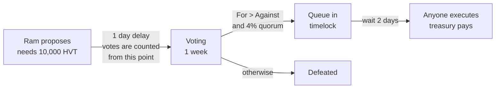

# Day 14 — DAO (token voting with a timelock)

## What I built

A small DAO, the **Himal DAO**. Members hold HVT tokens, and 1 token is 1 vote. Anyone with enough tokens can propose something, for example "pay 5 ETH from the treasury to a school library". Members vote for a week, and if the proposal passes it waits 2 more days in a timelock before anyone can run it.

It is built so that nobody can win a vote with borrowed money (a flash loan), spam the DAO with proposals, or reach the treasury without a vote.

## How it works



1. **Tokens become votes.** `HimalVoteToken` is an ERC-20 with `ERC20Votes`. Holders call `delegate(self)` once to switch their votes on (or delegate to someone they trust). The token remembers everyone's votes at every block, like a photo album.
2. **Propose.** `HimalDAO.propose()` needs 10,000 HVT (1% of the supply) of votes from one block earlier. Every description must end with `#proposer=<your address>`, so nobody can copy your proposal and cancel it.
3. **Wait, then vote.** After a 1-day delay (7,200 blocks) the DAO takes its "photo": votes are read from that past block. Members vote For, Against or Abstain for 1 week (50,400 blocks).
4. **Pass or fail.** A proposal passes if For beats Against and For + Abstain reach 4% of the supply (40,000 HVT).
5. **Timelock.** A passed proposal is queued in `HimalTimelock`, which holds the treasury. After 2 days anyone can call `execute()`. The deployer gave up all its powers at deployment, so the only way to move the money is a vote.

Why the "photo" matters: a flash loan lets anyone borrow millions of tokens for one transaction. If votes were counted from your balance *right now*, a borrower could propose, vote, execute and repay in one go. Here, votes come from a past block, when the borrower had nothing, so the loan is worth 0 votes.

Think of it as a village committee. To put an idea on the agenda you need some standing in the village. The list of who may vote is written down the day before voting starts, so people who arrive with borrowed land papers on voting day do not count. And after a decision, the money is released two days later, so anyone who disagrees has time to act.

## Run it yourself

```bash
git clone https://github.com/Khadka1996/30-Days-of-Building-Blockchain.git
cd 30-Days-of-Building-Blockchain/day-14
npm install --legacy-peer-deps
npm test          # 34 tests, including flash-loan attack contracts and 100 random fuzz runs
npm run demo      # a full proposal from start to finish, then the attacks
npm run lint      # solhint
npm run slither   # needs: pip install slither-analyzer
```

## Results from my run

```
34 passing

=== Himal DAO: 1,000,000 HVT, treasury 20 ETH ===
Voting delay / voting period                  7200 blocks (~1 day) / 50400 blocks (~1 week)
Proposal threshold / quorum                   10,000 HVT (1%) / 4% of supply
Timelock delay                                48 hours
Deployer still admin of the treasury?         false
Ram's votes before delegating                 0 HVT
Ram delegates to himself                      200,000 votes, gas used: 95667

=== Proposal: Grant: 5 ETH for the Bhaktapur school library ===
Gita (5,000 HVT) tries to propose it          reverted with GovernorInsufficientProposerVotes
Hari copies Ram's proposal (Ram's tag)        reverted with GovernorRestrictedProposer
Ram proposes                                  Pending, gas used: 110695
Sita votes before the delay is over           reverted with GovernorUnexpectedProposalState
After 7,200 blocks                            Active
Ram votes For                                 200,000 HVT, gas used: 83425
Sita votes Against                            120,000 HVT
Hari votes For                                75,000 HVT
Attacker flash-borrows 600,000 HVT and votes  vote weight counted: 0
Attacker flash-borrows to make a proposal     reverted with GovernorInsufficientProposerVotes
Tally (For / Against / Abstain)               275,000 / 120,000 / 0
After the voting week                         Succeeded
Queued in the timelock                        Queued
Execute straight away                         reverted with TimelockUnexpectedOperationState
2 days later, anyone executes                 Executed, gas used: 200890
School received                               5 ETH
Projects on the community fund board          1
Treasury left                                 15 ETH

=== The naive DAO (votes = balance right now, no delay), treasury 10 ETH ===
Borrow, propose, vote, execute, repay         one transaction, gas used: 227183
Attacker gained                               10 ETH
Naive DAO treasury left                       0 ETH
Tokens the attacker owns afterwards           0
```

solhint: 0 warnings · npm audit: 0 vulnerabilities · slither: 0 results · mutation check: 10 of 10 broken versions caught

## What I learned

- **Count votes from the past, never from "now".** The naive DAO lost its whole 10 ETH treasury to someone who owned 0 tokens, in one transaction. Reading votes from a snapshot block makes a flash loan worth 0 votes, and the voting delay plus timelock mean nothing can happen in the same transaction anyway.
- **The deploy script is part of the security.** The contracts were fine, but if the deployer forgets to renounce its admin role on the timelock, it can still empty the treasury without a vote. My tests check the deployed roles, not just the code.
- **An optional safety feature is easy to skip.** OpenZeppelin lets you tag a proposal with `#proposer=…` so nobody can copy it and cancel it, but the tag is optional. I made it required, and also reject tags the default would silently ignore, like a checksummed address or a trailing space.

## Security notes

Six findings from the review (two high, four medium), all fixed and each proven with a test, plus the known design limits (like votes bought during the 1-day delay): see **[QA.md](QA.md)**.

## References

- [OpenZeppelin — How to set up on-chain governance](https://docs.openzeppelin.com/contracts/5.x/governance)
- [OpenZeppelin — Governor API (including the proposer tag)](https://docs.openzeppelin.com/contracts/5.x/api/governance)
- [OpenZeppelin — ERC20Votes](https://docs.openzeppelin.com/contracts/5.x/api/token/erc20#ERC20Votes)
- [EIP-3156: Flash Loans](https://eips.ethereum.org/EIPS/eip-3156)
- [Rekt — Beanstalk: a $182M flash-loan governance attack](https://rekt.news/beanstalk-rekt/)

## Next

**Day 15 — Staking with rewards:** lock tokens and earn rewards every second.
