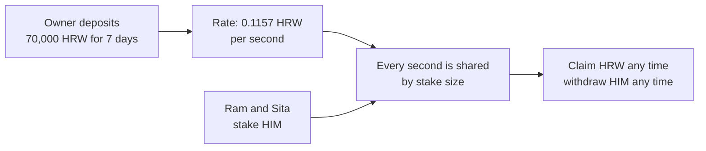

# Day 15 — Staking with rewards

## What I built

A staking pool, **Himal Staking**. You lock HIM tokens in it and earn HRW reward tokens **every second** you stay. The owner puts in a pot of rewards (for example 70,000 HRW for 7 days), and each second's share is split between everyone staked at that moment, by how much they staked.

It is built so that nobody can jump in just before a payout and grab rewards they did not wait for, and so that rounding never quietly eats people's rewards.

## How it works



1. **Stake.** `stake(amount)` locks your HIM. You start earning from the next second.
2. **Rewards in.** The owner calls `notifyRewardAmount(70,000 HRW, 7 days)`. The tokens are pulled in first, so the pool never promises rewards it does not hold. Rate = 70,000 ÷ 604,800 seconds = 0.1157 HRW per second.
3. **The trick: reward per token.** Updating every staker every second would cost far too much gas. Instead the pool keeps one running number, `rewardPerToken`: how much 1 staked token has earned since the start. Your reward = your stake × (rewardPerToken now − rewardPerToken when you last settled). Every stake, withdraw and claim settles you first.
4. **Claim or leave.** `getReward()` pays what you earned, `withdraw()` returns your HIM, `exit()` does both. There is no pause: you can always leave.

Think of a tea shop that gives away 1 cup of tea every minute, shared by everyone sitting inside. If you sit for an hour you get your share of 60 cups. If you walk in at the last minute, you get a share of 1 cup, not of the whole day's tea.

**Why per second matters.** A naive pool that pays each deposit out at once to whoever is staked at that moment can be gamed: watch for the deposit, stake just before it, claim, leave. In my test the attacker took **9,000 of 10,000 HRW** from the naive pool. In Himal Staking the same move earned **0.10 HRW** out of 70,000.

**Why rounding matters.** Solidity has no decimals, so every division rounds down. The common formula stores the rate as a whole number per second: 100 dollar-tokens (6 decimals) over a year gives 3.17 units per second, stored as 3, and **5.39 dollars are stuck forever**. Himal Staking stores the rate and reward per token multiplied by 10³⁶, so the same reward pays out 99.999999.

## Run it yourself

```bash
git clone https://github.com/Khadka1996/30-Days-of-Building-Blockchain.git
cd 30-Days-of-Building-Blockchain/day-15
npm install --legacy-peer-deps
npm test          # 25 tests, including attack contracts and 70 random fuzz runs
npm run demo      # a full staking week, then the two attacks
npm run lint      # solhint
npm run slither   # needs: pip install slither-analyzer
```

## Results from my run

```
25 passing

=== Himal Staking: lock HIM, earn HRW every second ===
Ram stakes 1,000 HIM                              gas used: 119597
Owner adds 70,000 HRW for 7 days                  gas used: 135242
Reward rate                                       0.115741 HRW per second
Day 3.5: Ram has earned                           35,000.00 HRW (alone so far)
Day 3.5: Sita stakes 3,000 HIM                    gas used: 131457
Day 7: Ram earned (1,000 HIM all week)            43,750.09 HRW
Day 7: Sita earned (3,000 HIM, half the week)     26,249.91 HRW
Paid out of 70,000                                70,000.00 HRW (lost to rounding: 1 wei)
Ram claims                                        gas used: 103938
Sita exits (withdraw + claim)                     gas used: 104065

=== Attack 1: stake just before the payout, leave right after ===
NAIVE pool (pays deposits out at once)            attacker took 9,000.00 of 10,000 HRW
  Ram, staked for 30 days, got                    1,000.00 HRW
HIMAL pool (pays per second)                      attacker took 0.1042 of 70,000 HRW

=== Attack 2: rounding (a 6-decimal dollar token, like USDC) ===
100 USD6 over 1 year: classic rate per second     3 units (true value 3.17)
CLASSIC paid                                      94.608000 USD6 (stuck forever: 5.392000)
HIMAL paid (rate scaled by 1e36)                  99.999999 USD6
```

solhint: 0 warnings · npm audit: 0 vulnerabilities · slither: 0 results · mutation check: 11 of 11 broken versions caught

## What I learned

- **Pay by time, not by snapshot.** Paying a deposit to whoever is staked at that instant rewards whoever moves fastest. Streaming per second, and settling each account before its balance changes, means you only earn for time you were really there.
- **1e18 is not always enough precision.** My first build used the usual 1e18 scale. My tests caught that with a 6-decimal reward token, an attacker who just called `getReward()` 200 times wiped out 20% of everyone's rewards. Scaling by 1e36 fixed it.
- **Every division needs a plan for its remainder.** Rewards for seconds when nobody was staked, the remainder of `reward ÷ duration`, the leftover of an old period: each one is a place where money can get stuck. Here each is either kept and paid later or limited to a few wei.

## Security notes

Seven findings from the review (one high, six medium), all fixed and each proven with a test, plus the known design limits (like the owner being trusted to set fair periods): see **[QA.md](QA.md)**.

## What a real protocol adds

- **Governance over rewards:** the reward schedule is set by a DAO through a timelock (Day 14), not by one owner key.
- **Many reward tokens and boosts:** for example Curve's gauges, which boost your rewards if you also lock the governance token.
- **Lock-ups and cooldowns:** some protocols make you wait before withdrawing, to keep the pool stable.
- **Audits and a bug bounty** on the exact deployed code, and monitoring for unusual withdrawals (Day 27).

## References

- [Synthetix StakingRewards.sol (the original per-second staking contract)](https://github.com/Synthetixio/synthetix/blob/develop/contracts/StakingRewards.sol)
- [Solidity by Example — Staking Rewards](https://solidity-by-example.org/defi/staking-rewards/)
- [OpenZeppelin — ReentrancyGuard](https://docs.openzeppelin.com/contracts/5.x/api/utils#ReentrancyGuard)
- [OpenZeppelin — SafeERC20](https://docs.openzeppelin.com/contracts/5.x/api/token/erc20#SafeERC20)
- [Solidity docs — Types (integer division rounds down)](https://docs.soliditylang.org/en/v0.8.24/types.html)

## Next

**Day 16 — Mini lending pool:** deposit to earn interest, borrow against collateral, and liquidations.
