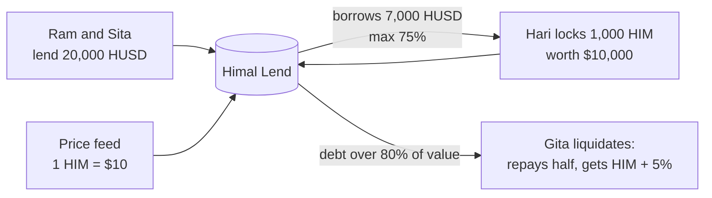

# Day 16 — Mini lending pool

## What I built

A lending pool, **Himal Lend**. Lenders put in HUSD (a dollar token) and earn interest. Borrowers lock HIM tokens as collateral and borrow HUSD against them, up to 75% of what the HIM is worth. If the HIM price falls too far, anyone can **liquidate** the loan: pay back part of it and take that much HIM plus a 5% bonus, so the lenders' money stays safe.

It is built against the two big dangers of lending: **price manipulation** (tricking the pool about what the collateral is worth) and **bad debt** (loans the collateral can no longer cover).

## How it works



1. **Lend.** `deposit(amount)` gives you shares of the pool. As borrowers pay interest, each share is worth more HUSD. `redeem(shares)` gives HUSD back, as long as it is not lent out right now.
2. **Borrow.** `depositCollateral(HIM)`, then `borrow(HUSD)` up to **75%** of the collateral's value (the *loan-to-value*, LTV). Value comes from a **price feed** shaped like Chainlink's, never from a swap pool.
3. **Interest.** The rate depends on how much of the pool is lent out (*utilisation*): 2% a year when nothing is borrowed, 10% at 80%, then steeply up to 100% at full use, so borrowers are pushed to repay before lenders get stuck. 10% of the interest goes to **reserves**, a safety cushion.
4. **Health factor** = collateral value × 80% ÷ debt. Above 1.0 you are safe. Below 1.0 anyone can `liquidate()`: repay up to half the debt and receive that value in HIM plus 5%.
5. **Bad debt.** If the collateral is worth less than the debt, the whole loan can be closed at once. Whatever is still owed when the collateral runs out is **written off**: reserves pay first, then every lender loses the same share.

Think of a pawn shop. You leave a gold necklace worth Rs 10,000 and borrow Rs 7,000. If the price of gold falls so much that the necklace barely covers the loan, the shop sells it before it is worth less than what you owe. And the shop checks the price of gold in the newspaper, not by asking the man at the door who just bought gold from himself.

**Why the price source matters.** A pool that values HIM at a swap pool's *spot* price can be fooled by one big trade. In my test the attacker spent 30,000 HUSD to push HIM from **$1.00 to $15.96**, borrowed all **50,000 HUSD** against 4,200 HIM (really worth $4,200), sold the rest back and walked away with **42,690 HUSD** profit. Himal Lend reads the price feed, which the trade does not move: the same attacker could borrow at most 3,150.

## Run it yourself

```bash
git clone https://github.com/Khadka1996/30-Days-of-Building-Blockchain.git
cd 30-Days-of-Building-Blockchain/day-16
npm install --legacy-peer-deps
npm test          # 21 tests, including the price-manipulation attack and 40 random fuzz runs
npm run demo      # a year of lending, a liquidation, a crash with bad debt, then the two attacks
npm run lint      # solhint
npm run slither   # needs: pip install slither-analyzer
```

## Results from my run

```
21 passing

=== Himal Lend: lend HUSD, borrow against HIM ===
Ram lends 10,000 HUSD                             gas used: 142905
Sita lends 10,000 HUSD                            gas used: 91605
Hari locks 1,000 HIM (price $10 = $10,000)        gas used: 85135
Hari borrows 7,000 HUSD (70% of value)            gas used: 112698
Hari tries 1,000 more (would be 80%)              refused: Unhealthy
Utilisation / borrow rate / lender rate           35.00% / 5.50% / 1.73% a year
Hari's health factor                              1.143
1 year later: Hari owes                           7,385.00 HUSD (interest 385.00)
  lenders' share of the interest (90%)            346.50 HUSD
  reserves (10%)                                  38.50 HUSD

=== HIM falls to $8.50: a normal liquidation ===
Hari's health factor                              0.921 (below 1.000 = liquidatable)
Gita repays (max 50% of the debt)                 3,692.50 HUSD   gas used: 119167
Gita receives                                     456.13 HIM = $3,877.13 (5% bonus)
Hari's health factor after                        1.002

=== HIM crashes to $3: bad debt, written off openly ===
Hari owes / his collateral is worth               3,692.50 HUSD / $1,631.60
Gita repays / takes all the collateral            1,553.91 HUSD / 543.87 HIM
Bad debt written off                              2,138.59 HUSD
  paid by reserves first                          38.50 HUSD
Ram withdraws everything                          9,123.20 HUSD (lent 10,000.00)
Sita withdraws everything                         9,123.20 HUSD (lent 10,000.00)
Left in the pool                                  0.000000 HUSD (nobody stuck)

=== Attack 1: price manipulation with one big trade ===
Swap pool spot price: before / after the buy      $1.00 / $15.96
NAIVE pool (spot price): attacker borrows         50,000.00 HUSD against 4,200 HIM ($4,200)
  attacker profit after selling back              42,690.24 HUSD; the pool is left with bad debt
HIMAL pool (price feed): borrow 50,000            refused: Unhealthy (max 3,150.00 HUSD)

=== Attack 2: borrowing on an old price ===
Feed last updated 2 hours ago: Sita borrows       refused: StalePrice
```

solhint: 0 warnings · npm audit: 0 vulnerabilities · slither: 0 results · fuzz: 400 extra runs green · mutation check: 14 of 14 broken versions caught

## What I learned

- **The price source is the security.** All the maths can be right and the pool still gets drained if it believes a price someone can move in one transaction. Use a feed that trading cannot push, and refuse prices that are old, zero or negative.
- **Bad debt must be admitted, not hidden.** When HIM crashed to $3, 2,138.59 HUSD could never be repaid. If the pool kept counting it, the first lenders out would get full value and the last would find an empty pool. Writing it off makes Ram and Sita lose exactly the same: 876.80 each.
- **Round in the pool's favour, every time.** Debt rounds up, payouts round down. With debt rounding down, someone could borrow 1 wei at a time and owe nothing; a mutation test proved the tests catch it.

## Security notes

Eight findings from the review (two high, six medium), all fixed and each proven with a test, plus the known design limits (like the price reporter being trusted): see **[QA.md](QA.md)**.

## What a real protocol adds

- **Real oracles:** Chainlink feeds with heartbeat and deviation rules, often a second oracle (or a time-weighted price) as a cross-check.
- **Many markets:** many collateral types, each with its own LTV, liquidation threshold and bonus, plus supply and borrow caps.
- **Governance and guardians:** risk settings changed through a DAO and timelock (Day 14), and a guardian who can pause new borrows (never repayments) in an emergency.
- **Liquidation bots and audits:** a network of bots watching every block, an insurance fund or safety module for bad debt, audits and a bug bounty.

## References

- [Compound III (Comet) documentation](https://docs.compound.finance/)
- [Aave V3 core contracts and technical paper](https://github.com/aave/aave-v3-core)
- [Chainlink — Using Data Feeds (check `updatedAt`)](https://docs.chain.link/data-feeds/using-data-feeds)
- [OpenZeppelin — ERC-4626 inflation attack and virtual shares](https://docs.openzeppelin.com/contracts/5.x/erc4626)
- [samczsun — So you want to use a price oracle](https://www.paradigm.xyz/2020/11/so-you-want-to-use-a-price-oracle)

## Next

**Day 17 — Swap with a router:** a swap pool plus a router that finds the path A → B → C.
