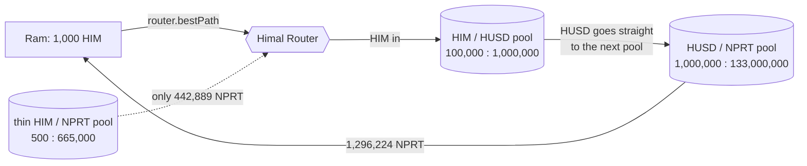

# Day 17 — Swap with a router

## What I built

A small decentralised exchange, **Himal Swap**. Each **pool** holds two tokens and prices them with the rule *x × y = k*. A **router** lets you swap along a path of pools, like **HIM → HUSD → NPRT**, and finds the path that gives you the most.

It is built against the two big dangers of swapping: **slippage** (getting a worse price than you expected) and **sandwich attacks** (a bot trading right before and right after you to take the difference).

## How it works



1. **Pools (`HimalPair`).** A pool keeps `reserveA × reserveB` from going down. Buy HIM and you add HUSD, so HIM gets scarcer and its price goes up. Each trade pays a **0.3% fee** that stays in the pool for the liquidity providers, who own **LP tokens** (their share of the pool).
2. **Factory (`HimalFactory`).** Creates exactly one pool per token pair and remembers where it is.
3. **Router (`HimalRouter`).**
   - `bestPath(A, C, amount)` compares the direct pool with going through a **connector** token (HUSD): A → HUSD → C.
   - `swapExactTokensForTokens` sells an exact amount; `swapTokensForExactTokens` buys an exact amount.
   - Tokens go from you straight into the first pool, then from pool to pool, then to you. The router never holds anything.
4. **Two guards on every trade.** A **slippage limit** (`amountOutMin` or `amountInMax`): the worst price you accept, or the whole transaction reverts. A **deadline**: after it, the transaction refuses to run.

Think of changing money at a counter where every exchange moves the rate. You tell the cashier: "I want at least Rs 13,200 for my $100, and only if this happens in the next 20 minutes." If someone pushes in front of you and moves the rate, you simply do not trade.

**Why the slippage limit matters.** In my test the attacker saw Ram's 50,000 HUSD swap waiting, paid a higher tip to go first, bought HIM, let Ram buy at the higher price, then sold right after. All three trades in **one block**. With no limit, Ram got **3,325.27 HIM instead of 4,748.03 (29.97% less)** and the attacker kept **14,425.55 HUSD**. With a 0.5% limit, Ram's swap simply reverted, he lost nothing, and the attacker was left **999.51 HUSD down** from paying two fees.

## Run it yourself

```bash
git clone https://github.com/Khadka1996/30-Days-of-Building-Blockchain.git
cd 30-Days-of-Building-Blockchain/day-17
npm install --legacy-peer-deps
npm test          # 26 tests, including a real one-block sandwich attack and 40 random fuzz runs
npm run demo      # best path, exact output, price impact, the sandwich with and without a limit, a late swap
npm run lint      # solhint
npm run slither   # needs: pip install slither-analyzer
npm run mutate    # breaks 16 important lines one at a time; the tests must catch each (a few minutes)
```

## Results from my run

```
26 passing

=== Himal Swap: three pools (x × y = k, 0.3% fee) ===
HIM/HUSD                                          100,000 : 1,000,000   price 10.00
HUSD/NPRT                                         1,000,000 : 133,000,000   price 133.00
HIM/NPRT (thin)                                   500 : 665,000   price 1,330.00

=== Ram sells 1,000 HIM for NPRT: the router finds the path ===
Direct pool HIM → NPRT would give                 442,889.11 NPRT
bestPath chooses                                  HIM → HUSD → NPRT: 1,296,224.03 NPRT
Ram swaps with a 0.5% slippage limit              got 1,296,224.03 NPRT   gas used: 148106
Router balance after (it never holds tokens)      0.00

=== Sita buys exactly 1,000 HIM (exact output) ===
She pays                                          9,931.08 HUSD (limit +0.5%)   gas used: 98189

=== Price impact: bigger trades get worse prices ===
Buy HIM with 1,000 HUSD                           99.59 HIM, 0.39% worse than spot (incl. fee)
Buy HIM with 10,000 HUSD                          987.10 HIM, 1.28% worse than spot (incl. fee)
Buy HIM with 100,000 HUSD                         9,065.62 HIM, 9.33% worse than spot (incl. fee)

=== Attack: a sandwich in ONE block (attacker tip 100 gwei, Ram 2, attacker 1) ===
Ram swaps 50,000 HUSD; the fair quote is          4,748.03 HIM
NO slippage limit (amountOutMin = 0)              order in block: 0, 1, 2, all succeed
  Ram gets                                        3,325.27 HIM (29.97% less)
  attacker profit                                 14,425.55 HUSD, in one block
WITH a 0.5% limit                                 Ram's swap reverts: InsufficientOutputAmount
  Ram loses                                       0 HUSD (he keeps his money, pays only gas)
  attacker profit                                 -999.51 HUSD (two fees, no victim)

=== A swap that waited 2 hours in the queue ===
Deadline was 20 minutes                           refused: Expired
```

solhint: 0 warnings · npm audit: 0 vulnerabilities · slither: 0 results · fuzz: 400 extra runs green · mutation check: 16 of 16 broken versions caught

## What I learned

- **The slippage limit is the real protection.** The pool maths was right in every case; Ram was still robbed of 29.97% because he said "any price is fine". One number, `amountOutMin`, turned the same attack into a loss for the attacker.
- **A limit is a ceiling, not a shield.** A smaller sandwich that stays inside Ram's 0.5% still works (a test proves it). So the tolerance should be as tight as the trade allows, and big trades should be split or sent privately.
- **Two hops can beat one.** Selling 1,000 HIM in the thin direct pool gave 442,889 NPRT; going through two deep pools gave 1,296,224, almost 3× more, even after paying the fee twice. For a tiny trade the direct pool wins, and the router picks it.

## Security notes

Eight findings from the review (one high, seven medium), all fixed and each proven with a test, plus the known design limits (like `bestPath` reading prices one trade can move): see **[QA.md](QA.md)**.

## What a real protocol adds

- **Better routing:** Uniswap's and 1inch's routers search many pools and fee tiers, split one trade across several paths, and run off-chain; the contract only checks the final amount.
- **Concentrated liquidity and price oracles:** Uniswap V3/V4 let providers put liquidity in a price range, and every pool records a time-weighted average price (TWAP) that one trade cannot move.
- **Sandwich protection outside the contract:** private transaction relays (for example Flashbots Protect), batch auctions like CoW Swap, and wallets that set tight slippage by default.
- **Flash swaps, permit signatures and audits:** borrow from a pool inside a swap (Day 18), approve with a signature instead of a transaction, and years of audits and bug bounties.

## References

- [Uniswap V2 whitepaper](https://docs.uniswap.org/whitepaper.pdf)
- [Uniswap V2 core contracts (`UniswapV2Pair.sol`)](https://github.com/Uniswap/v2-core)
- [Uniswap V2 periphery (`UniswapV2Router02.sol`)](https://github.com/Uniswap/v2-periphery)
- [Ethereum.org — Maximal extractable value (MEV) and sandwich attacks](https://ethereum.org/en/developers/docs/mev/)
- [Flashbots Protect — sending transactions privately](https://docs.flashbots.net/flashbots-protect/overview)

## Next

**Day 18 — Flash loans:** borrow and repay in one transaction, with an arbitrage example.
