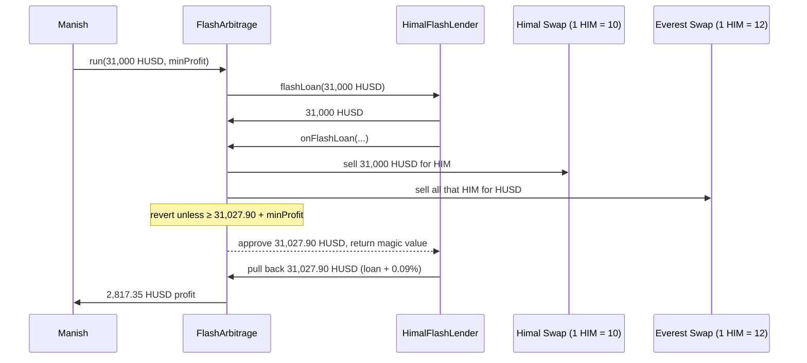

# Day 18 — Flash loans

## What I built

A **flash lender**, **Himal Flash**: it lends millions of tokens with no collateral, because the loan must be paid back (plus 0.09%) **in the same transaction**, or everything is undone as if it never happened. With it I built an **arbitrage bot** that borrows HUSD, buys HIM where it is cheap, sells it where it is dear, repays, and keeps the difference, starting with **0 of its own money**.

Then the dark side: a "loyalty bonus" that pays on how much HIM you hold *right now*. With a flash loan, the attacker looked rich for one transaction and **took the whole 10,000 HUSD pot for a 90 HIM fee**. The fixed version looks at balances in a past block, and the same attack fails.

## How it works



1. **The lender (`HimalFlashLender`, ERC-3156).** In one call it (a) sends you the money, (b) calls your contract's `onFlashLoan`, (c) pulls back `amount + fee` with `transferFrom`, and (d) checks its balance really grew by the fee. If any step fails, the whole transaction reverts. The fee is **0.09%, rounded up**, so even a 1-wei loan pays 1 wei.
2. **The borrower (`FlashArbitrage`).** Only Manish can start it. In the callback it buys HIM on Himal Swap, sells it on Everest Swap (the Day 17 exchange, deployed twice with different prices), and reverts unless what is left covers the loan, the fee **and** `minProfit`. Profit goes straight to Manish; the bot keeps nothing.
3. **The borrower's two checks.** `onFlashLoan` only accepts calls **from the lender** and only for loans **it started itself** (`initiator == address(this)`). Without the second check, anyone can start loans *for* your bot and make it pay the fees.
4. **The attack, and the fix.** `NaiveBonus` pays 1 HUSD per 10 HIM in `balanceOf(you)`, read at the moment you claim. `SafeBonus` asks the HIM token (ERC20Votes, like Day 14) how much you held at a **block that is already in the past**. A flash loan is repaid inside one transaction, so it never appears in history.

Think of a bank that lends you Rs 1 crore on one condition: you must give it back before you leave the counter. You cannot run away with it, so the bank needs no guarantee. But if a shop next door gives a gift to "anyone holding Rs 1 crore", you can walk in, show the money, take the gift and walk back. The fix is for the shop to ask: "How much did you have in your account **last month**?"

## Run it yourself

```bash
git clone https://github.com/Khadka1996/30-Days-of-Building-Blockchain.git
cd 30-Days-of-Building-Blockchain/day-18
npm install --legacy-peer-deps
npm test          # 29 tests, including the bonus attack, bad borrowers and 40 random fuzz runs
npm run demo      # the lender, the arbitrage (best size), the bonus attack and its fix, a stranger draining a bot
npm run lint      # solhint
npm run slither   # needs: pip install slither-analyzer
npm run mutate    # breaks 17 important lines one at a time; the tests must catch each (a few minutes)
```

## Results from my run

```
29 passing

=== The flash lender (ERC-3156, fee 0.09% rounded up) ===
Can lend                                          2,000,000 HUSD and 1,000,000 HIM
Fee on 1,000,000 HUSD                             900.00 HUSD
Fee on a 1-wei loan                               1 wei (never free)

=== Two exchanges, two prices for HIM ===
Himal Swap   (100,000 HIM : 1,000,000 HUSD)       1 HIM = 10.00 HUSD
Everest Swap  (50,000 HIM :   600,000 HUSD)       1 HIM = 12.00 HUSD

=== Arbitrage: borrow HUSD, buy HIM cheap, sell dear, repay ===
  borrow 10,000 HUSD                              profit 1,573.37 HUSD
  borrow 50,000 HUSD                              profit 1,850.14 HUSD
  borrow 200,000 HUSD                             profit -50,798.90 HUSD
  borrow 400,000 HUSD                             profit -182,892.93 HUSD
Best size (searched in steps of 1,000)            31,000 HUSD → profit 2,817.35 HUSD
Manish runs the bot (own money: 0 HUSD)           received 2,817.35 HUSD   gas used: 330039
Lender earned                                     27.90 HUSD fee (= 27.90)
Bot keeps after the run                           0.00 HUSD, 0.00 HIM
Prices after                                      Himal 10.63 · Everest 10.68
Run it again (the gap is gone)                    refused: NotProfitable, nothing lost but gas

=== Attack: look rich for one transaction (bonus 1 HUSD per 10 HIM, pot 10,000 HUSD) ===
Attacker holds                                    1,000 HIM (bought after the snapshot)
NaiveBonus: flash-borrow 100,000 HIM and claim    attacker got 10,000.00 HUSD   gas used: 255620
  cost to the attacker                            90.00 HIM fee (about 900.00 HUSD)
  Ram (a real holder of 1,000 HIM) claims         refused: NothingToClaim, the pot is empty
SafeBonus (balance at a past block): same attack  reverts: NothingToClaim, pot still 10,000 HUSD
  Ram and Sita claim from SafeBonus               100.00 and 500.00 HUSD (exactly 1 per 10 HIM)

=== Attack: a stranger starts flash loans FOR someone else's bot ===
Bot WITHOUT the initiator check (1,000 saved)     after one loan: 100.00 HUSD left (paid the 900 fee)
FlashArbitrage (checks initiator)                 refused: UntrustedInitiator, still 1,000.00 HUSD
```

solhint: 0 warnings · npm audit: 0 vulnerabilities · slither: 0 results · fuzz: 400 extra runs green · mutation check: 17 of 17 broken versions caught

## What I learned

- **A flash loan turns "how much do you hold?" into a free question to fake.** Anything that reads a balance, a price or a vote *right now* can be fooled for one transaction. The attacker paid a 90 HIM fee and took 10,000 HUSD. Reading a past block (or a time-weighted price, Day 16 and 17) is the fix.
- **The borrower has to defend itself too.** ERC-3156 lets anyone start a loan for any receiver. A bot that forgot `initiator == address(this)` lost 900 of its 1,000 HUSD in one stranger's transaction.
- **Bigger is not better in arbitrage.** 31,000 HUSD earned 2,817.35; 200,000 would have lost 50,798.90, because every buy moves the price. The `minProfit` check makes a bad trade cost only gas.

## Security notes

Eight findings from the review (three high, two medium, three low), all fixed and each proven with a test, plus the known design limits (like the bonus needing holders to delegate): see **[QA.md](QA.md)**.

## What a real protocol adds

- **Pooled liquidity:** Aave and Balancer lend depositors' money and share the fees with them; here the owner funds the lender.
- **Flash mints and flash swaps:** some tokens mint the loan out of thin air (OpenZeppelin `ERC20FlashMint`, MakerDAO's DAI flash mint), and Uniswap pools lend you the output before you pay (flash swaps).
- **Private order flow:** real arbitrage bots race each other and send transactions through private relays (for example Flashbots) so nobody copies the trade first.
- **Flash-loan-proof designs:** governance with vote snapshots and delays (Day 14), time-weighted price oracles, and "no deposit and withdraw in the same block" rules. Beanstalk lost about $182M in 2022 to a flash-loan governance vote with no delay.

## References

- [EIP-3156: Flash Loans](https://eips.ethereum.org/EIPS/eip-3156)
- [OpenZeppelin — `ERC20FlashMint` and the ERC-3156 interfaces](https://docs.openzeppelin.com/contracts/5.x/api/token/erc20#ERC20FlashMint)
- [Aave — Flash loans guide](https://docs.aave.com/developers/guides/flash-loans)
- [Uniswap V2 — Flash swaps](https://docs.uniswap.org/contracts/v2/guides/smart-contract-integration/using-flash-swaps)
- [Rekt — Beanstalk, a flash-loan governance attack](https://rekt.news/beanstalk-rekt/)

## Next

**Day 19 — Mini stablecoin:** lock ETH, mint a dollar-pegged coin, and get liquidated if it falls too low.
