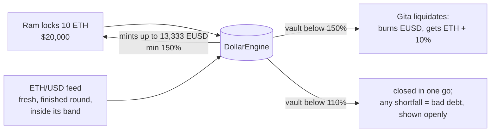

# Day 19 — Mini stablecoin

## What I built

A stablecoin, the **Everest Dollar (EUSD)**, that aims to be worth exactly $1. You lock ETH in a vault and mint EUSD against it, but only while your ETH is worth at least **150%** of what you minted. If ETH falls and your vault drops below 150%, anyone can **liquidate** it: burn some of your EUSD debt and take that value in ETH plus a 10% bonus. That keeps every EUSD backed by more than $1 of ETH, which is what keeps the coin at $1.

The day's focus is the **price**. A stablecoin is only as good as its ETH price: my tests show a naive version minting coins on a **stale** price and on a **stuck** price (the LUNA lesson) until each EUSD was backed by only **75 cents** or **90 cents**. The real engine refuses both.

## How it works



1. **Mint.** `depositAndMint(amount)` locks ETH and mints EUSD. The vault must stay at **150% or more** (10 ETH at $2,000 = $20,000 backs at most 13,333.33 EUSD). Every vault needs at least **100 EUSD** of debt, so none is too small to be worth liquidating, and there is a **debt ceiling** for the whole system.
2. **Repay and withdraw.** `repay(amount)` burns your EUSD; `withdraw(amount)` gives ETH back as long as what is left is still at 150%. With no debt you can always leave.
3. **Liquidate (110% … 150%).** Anyone can burn **up to half** of an unsafe vault's debt and get that value in ETH **plus 10%**. Taking 110% for every 100% repaid can never push a vault below 110%, so a normal liquidation never creates bad debt.
4. **Close (under 110%).** All or nothing: the liquidator takes **all** the ETH and must repay the **whole** debt if the ETH covers it, or at least the ETH's value minus 10% if it does not. What is still owed is written off as **bad debt**, in the open, never hidden.
5. **Trust the price only when it is safe.** The ETH price comes from a Chainlink-style feed and is refused if it is **more than 1 hour old**, from the future, from an unfinished round, or **sitting on the feed's floor or ceiling**. With a broken price, mint, liquidate and withdraw-with-debt stop, but **deposit and repay keep working**, because they only make things safer.

Think of a gold loan shop that gives you Rs 1,000 coupons. You leave gold worth Rs 1,500 for every 1,000 in coupons. If gold falls, the shop lets someone pay back your coupons and take your gold with a small reward, before the gold is worth less than the coupons. Everyone trusts a coupon to be worth Rs 1,000 because there is always more than Rs 1,000 of gold behind it. But the shop must check **today's** gold price in a newspaper that is still being printed. Yesterday's paper, or one whose lowest printable price is stuck, lets people walk out with too many coupons.

**Why the price checks matter.** Chainlink feeds have a built-in floor and ceiling (`minAnswer` / `maxAnswer`). In May 2022, the LUNA feed hit its floor of about $0.10 and kept reporting it while LUNA traded far lower. Lending pools that trusted it let people deposit near-worthless LUNA at the floor price and borrow real money. My `EthUsdFeed` copies that behaviour, and the engine refuses any price on the edge of the band.

## Run it yourself

```bash
git clone https://github.com/Khadka1996/30-Days-of-Building-Blockchain.git
cd 30-Days-of-Building-Blockchain/day-19
npm install --legacy-peer-deps
npm test          # 19 tests, including both price attacks and 40 random fuzz runs
npm run demo      # mint, a liquidation, a crash with bad debt, a feed outage, then the two attacks
npm run fuzz      # 400 random runs
npm run lint      # solhint
npm run slither   # needs: pip install slither-analyzer
npm run mutate    # breaks 19 important lines one at a time; the tests must catch each (a few minutes)
```

## Results from my run

```
19 passing

=== Everest Dollar: lock ETH, mint EUSD (min 150%) ===
ETH price (feed, band $500 … $100,000)            $2,000.00
Ram locks 10 ETH ($20,000), mints 12,000 EUSD     gas used: 176878
  Ram's collateral ratio                          166.7%
  Ram tries 1,400 more (limit 13,333.33)          refused: Unhealthy
Sita locks 10 ETH, mints 5,000 EUSD               400.0%
Gita (a liquidator) locks 100 ETH, mints 50,000   400.0%
EUSD in circulation / backing per EUSD            67,000.00 / $3.58

=== ETH falls 15% to $1,700: a normal liquidation ===
Ram's collateral ratio                            141.7% (below 150% = liquidatable)
Gita burns 6,000 EUSD (max 50% of the debt)       gas used: 81619
  Gita receives                                   3.8824 ETH = $6,600.00 (10% bonus)
  Ram's collateral ratio after                    173.3%
Backing per EUSD                                  $3.24

=== ETH crashes to $900: under 110% the vault closes in one go ===
Ram owes / his ETH is worth                       6,000.00 EUSD / $5,505.88 (91.8%)
Gita tries to repay just half                     refused: RepayTooSmall
Gita burns / takes ALL the ETH                    5,005.35 EUSD / 6.1176 ETH
Bad debt written off (EUSD with no ETH behind)    994.65 EUSD, shown openly
Backing per EUSD (whole system)                   $1.77 (still above $1)

=== The price feed goes quiet for 2 hours ===
Sita mints 100 EUSD                               refused: StalePrice
Gita liquidates anyone                            refused: StalePrice
Sita repays 1,000 EUSD (makes things safer)       allowed
Sita adds 1 ETH (makes things safer)              allowed

=== Attack 1: mint on a stale price (ETH really fell from $2,000 to $1,000) ===
NAIVE engine: 10 ETH → 13,333.33 EUSD             gas used: 176613
SAFE engine: same                                 refused: StalePrice
The truth arrives: naive backing per EUSD         $0.75 (the coin has lost its peg)

=== Attack 2: the feed is stuck on its $500 floor while ETH trades at $300 (LUNA) ===
Feed reports                                      $500 (clamped to its minAnswer)
NAIVE engine: 100 ETH ($30,000) → 33,333.33 EUSD  real backing per EUSD $0.90
SAFE engine: same                                 refused: PriceOutOfBounds
```

solhint: 0 warnings · npm audit: 0 vulnerabilities · slither: 0 results · fuzz: 400 extra runs green · mutation check: 19 of 19 broken versions caught

## What I learned

- **A stablecoin's peg is a promise about the price feed.** The coin is worth $1 only if the engine knows what the ETH behind it is worth. One stale hour let the naive engine mint coins backed by 75 cents each; a feed stuck on its floor gave 90 cents. Checking age, round and the feed's band stopped both.
- **Liquidations need rules, not just a bonus.** My first design let a liquidator repay a little, take all the ETH and keep the full 10%, leaving bad debt in a vault that was still solvent. "Under 110%, close it in one go" fixed it: at 104%, the liquidator must repay all 12,000 EUSD and the bad debt stays 0.
- **When the price breaks, let people make things safer.** During a feed outage, minting and liquidating stop, but repaying and adding ETH still work, and a debt-free vault can always leave.

## Security notes

Seven findings from the review (two high, three medium, two low), all fixed and each proven with a test, plus the known design limits (no stability fee, oracle front-running): see **[QA.md](QA.md)**.

## What a real protocol adds

- **Stability fees and a savings rate:** MakerDAO charges interest on vault debt and pays some of it to DAI holders, to push the price back to $1 from either side.
- **Auctions instead of a fixed bonus:** Maker sells liquidated collateral in Dutch auctions, so the market sets the discount.
- **Redemptions:** Liquity lets anyone swap 1 LUSD for $1 of ETH from the riskiest vault, which puts a hard floor under the price.
- **A backstop:** a surplus buffer and a stability pool absorb bad debt before it reaches holders; Maker can mint governance tokens to cover a shortfall.
- **Several oracles:** a medianiser or a backup feed, a delay on new prices (Maker's OSM) and an L2 sequencer check.

## References

- [MakerDAO — How vaults, liquidations and stability fees work](https://docs.makerdao.com/)
- [Liquity — Redemptions and the stability pool](https://docs.liquity.org/)
- [Chainlink — Using data feeds and checking `updatedAt`](https://docs.chain.link/data-feeds/using-data-feeds)
- [Chainlink — Data feeds: risks, `minAnswer` / `maxAnswer` and monitoring](https://docs.chain.link/data-feeds)
- [Rekt — Venus Protocol and the LUNA price feed (May 2022)](https://rekt.news/venus-blizz-rekt)

## Next

**Day 20 — Yield vault:** deposit tokens, the vault invests them and shares the profit (ERC-4626), protected against the first-depositor inflation attack.
