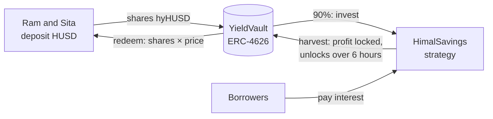

# Day 20 — Yield vault

## What I built

A **yield vault** for HUSD, the **Himal Yield Vault**. You deposit HUSD and get vault shares (hyHUSD). The vault keeps 10% as cash and lends the rest to a savings strategy that earns interest. When interest comes in, every share is worth more HUSD, so everyone earns in proportion to what they put in. It follows **ERC-4626**, the standard that wallets and other apps use to talk to vaults.

The day's focus is the **first-depositor inflation attack**. My tests show a naive vault where an attacker puts in 1 wei, sends 1,000 HUSD straight to the vault, and the next person's 1,000 HUSD deposit gets **0 shares**: the attacker walks away with all of it. In my vault the same attack makes the attacker **lose** money and the victim gets fair shares.

## How it works



1. **Deposit.** `deposit(assets, receiver)` gives you shares at today's price: `shares = assets × (all shares) ÷ (all HUSD in the vault)`. The first HUSD gets 1,000,000 shares (6 extra "virtual" decimals, see below).
2. **Invest.** `invest()` (anyone can call it) keeps 10% as cash for withdrawals and sends the rest to the strategy.
3. **Earn.** Borrowers pay interest to the strategy. `harvest()` (anyone can call it) records the profit. The profit is **locked** and unlocks in a straight line over **6 hours**, so the price of a share goes up slowly, not in one jump.
4. **Withdraw.** `redeem(shares, …)` pays `shares × price` in HUSD. If the cash is not enough, the vault brings the rest back from the strategy.
5. **Losses count at once.** If a borrower defaults, the share price drops straight away for everyone, so nobody can run out first at the old price.

Think of a village savings group. Everyone puts money in a shared box and gets a slip for their share. When the group lends out money and earns interest, each slip is worth a little more. Now imagine a trick: the first person puts in Rs 1, gets 1 slip, then secretly drops Rs 1,000 into the box. Now 1 slip "is worth" Rs 1,001, so when you bring Rs 1,000, it is worth less than one slip and the treasurer rounds you down to **zero** slips. The trickster cashes his 1 slip and takes your money too.

**How my vault stops it.**
- **Virtual shares:** the vault always behaves as if 1,000,000 shares and 1 wei already exist (`_decimalsOffset() = 6`, from OpenZeppelin). To push the price up, the attacker has to give most of the donation to these "ghost" shares, so the attack costs him far more than it can steal.
- **Own bookkeeping:** the vault counts its own cash (`idle`) instead of reading its token balance, so HUSD sent straight to it is simply ignored.
- **0 shares is refused,** and `depositWithMin` / `redeemWithMin` let a user set the worst price they accept.

## Run it yourself

```bash
git clone https://github.com/Khadka1996/30-Days-of-Building-Blockchain.git
cd 30-Days-of-Building-Blockchain/day-20
npm install --legacy-peer-deps
npm test          # 18 tests, including the inflation attack and 40 random fuzz runs
npm run demo      # deposits, interest shared over 6 hours, then the three attacks
npm run fuzz      # 400 random runs
npm run lint      # solhint
npm run slither   # needs: pip install slither-analyzer
npm run mutate    # breaks 14 important lines one at a time; the tests must catch each (about 2 minutes)
```

## Results from my run

```
18 passing

=== Himal Yield Vault: deposit HUSD, the vault invests it ===
Ram deposits 1,000 HUSD                             gas used: 142929
  Ram's shares (24 decimals: 6 virtual)             1,000.00 hyHUSD
Sita deposits 3,000 HUSD                            total 4,000.00 HUSD
invest(): 90% to HimalSavings, 10% kept as cash     gas used: 125457
  cash / in the strategy                            400.00 / 3,600.00

=== Borrowers pay 400 HUSD interest: profit unlocks over 6 hours ===
harvest() records 400 HUSD profit                   gas used: 68731
  value of 1 share right after the harvest          1.0000 HUSD
  after 3 hours                                     1.0500 HUSD
  after 6 hours                                     1.1000 HUSD
Ram redeems everything (put in 1,000)               1,100.000000 HUSD
Sita redeems everything (put in 3,000)              gas used: 88056
  Sita receives                                     3,300.000000 HUSD

=== Attack 1: the first-depositor inflation attack ===
NAIVE vault: attacker puts in 1 wei + gives 1,000   1 share = 1,000 HUSD
  Ram deposits 1,000 HUSD and receives              0 shares
  attacker redeems 1 share: profit                  +1,000.00 HUSD (all of Ram's)
SAFE vault, same donation                           totalAssets still 1 wei (ignored)
  Ram's 1,000 HUSD deposit is worth                 1,000.000000 HUSD
  attacker's result                                 -1,000.00 HUSD
SAFE vault, donation as 'interest' + 6 h wait       attacker's 1 wei is now worth 500.00 HUSD
  Ram's 1,000 HUSD deposit is worth                 999.999750 HUSD (loss 0.000250)
  attacker's result (virtual shares keep the rest)  -500.00 HUSD

=== Attack 2: profit sniping (jump in just before a harvest) ===
NO lock (1 second): Hari in 100,000, harvest, out   +384.6154 HUSD of the 400 (96.154%)
6-hour lock: Hari in 100,000, harvest, out          +0.0178 HUSD of the 400 (0.004%)

=== Attack 3: a borrower defaults on 1,000 HUSD (25% of the vault) ===
totalAssets before anyone calls harvest()           3,000.00 HUSD (loss counted at once)
Ram rushes to exit with his 1,000                   750.000000 HUSD (fair: -25%, like Sita)
Sita's 3,000 is now worth                           2,250.000000 HUSD
```

solhint: 0 warnings · npm audit: 0 vulnerabilities · slither: 0 results · fuzz: 400 extra runs green · mutation check: 14 of 14 broken versions caught

## What I learned

- **Rounding down is where the money goes.** The naive vault never "sends" Ram's money to the attacker; it just rounds his shares down to 0. With virtual shares the same trick cost the attacker 500 HUSD, and Ram lost only 0.00025 HUSD.
- **Never let a balance you do not control set your price.** Anyone can send tokens to a contract. Counting my own cash (`idle`) made the plain donation attack do nothing at all.
- **Profit must arrive slowly, and losses at once.** With the profit unlocked instantly, Hari took 96% of 400 HUSD interest by staying for one block. Unlocking over 6 hours cut that to 0.0178 HUSD. My first lock could be stalled by anyone paying 1 wei of interest every 10 minutes (144.5 HUSD still locked after 6 hours); a time average weighted by amount fixed it.

## Security notes

Seven findings from the review (two high, three medium, two low), all fixed and each proven with a test, plus the known design limits (a trusted strategy, no fees, virtual-share dust): see **[QA.md](QA.md)**.

## What a real protocol adds

- **Many strategies and a manager:** Yearn v3 vaults spread money over several strategies with debt limits, and a role can add or remove them.
- **Fees:** performance and management fees, paid by minting shares to a treasury.
- **Withdrawal queues and emergency shutdown,** for when a strategy cannot pay back at once.
- **Health checks** on every report, so a strategy cannot claim a huge profit or hide a loss.
- **Routers with slippage limits** (ERC-4626 router / EIP-5143) instead of adding them to the vault.

## References

- [EIP-4626 — Tokenized Vaults](https://eips.ethereum.org/EIPS/eip-4626)
- [OpenZeppelin — ERC-4626 and the inflation attack (virtual shares and decimals offset)](https://docs.openzeppelin.com/contracts/5.x/erc4626)
- [Yearn v3 — Vaults, profit unlocking and strategies](https://docs.yearn.fi/developers/v3/overview)
- [EIP-5143 — Slippage protection for tokenized vaults](https://eips.ethereum.org/EIPS/eip-5143)
- [MixBytes — Overview of the inflation attack](https://mixbytes.io/blog/overview-of-the-inflation-attack)

## Next

**Day 21 — Security & upgrades day:** attack all of Week 3 with fuzz and invariant tests, and upgrade one contract safely with a UUPS proxy.
