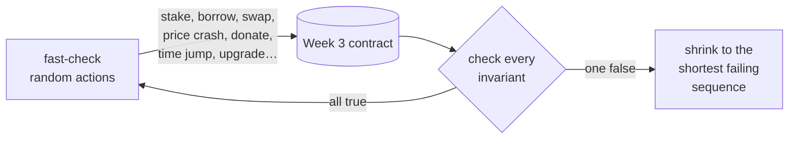

# Day 21 — Security & upgrades day

## What I built

Two things to close Week 3. First, an **attack robot** for four of this week's DeFi contracts (staking, lending, swap pool, yield vault): it throws thousands of random actions at them and, after every single one, checks rules that must always be true, like "the pool always holds the money its books say". Second, a **safe upgrade**: the Day 15 staking contract now sits behind a **UUPS proxy**, so I upgraded it from V1 to V2 (adding an emergency pause) while people were staked, without moving a single token. My tests also show four upgrade mistakes, including a **storage clash** that turns the staking token into the reward token and locks everyone's money.

## How it works

### 1. Invariant fuzzing: random attacks, fixed rules



An **invariant** is a rule that must hold no matter what anyone does. A normal test checks one story you thought of; a fuzzer writes thousands of stories you did not think of. Think of a bank inspector who walks in at random times, after every customer, and counts the cash in the vault against the ledger.

- **Staking (Day 15):** the same actions go to the original contract and to the proxy version **in the same block**, and both must agree on every number, even when the proxy is upgraded to V2 half-way through a run.
- **Lending (Day 16):** borrowers borrow, the HIM price crashes, liquidators step in. Nobody ever ends above their limit, borrowing 1 wei over the limit always fails, and lenders only lose value when bad debt is written off openly.
- **Swap (Day 17):** the value of an LP share never drops, and a swap asking for 1 wei more than the formula always fails.
- **Vault (Day 20):** the vault never counts money it does not have, new profit never shows up at once, and a quick in-and-out never earns more than the profit unlocked meanwhile.

To check that the robot really bites, `npm run mutate` plants **15 bugs** one at a time; the tests must fail for each one.

### 2. UUPS upgrade: same address, new code

```
          users always call this address
                     │
            ┌────────▼────────┐  delegatecall   ┌──────────────────┐
            │  ERC1967Proxy    │ ──────────────▶ │ HimalStakingV1   │  (logic, no tokens)
            │  holds ALL the   │                 └──────────────────┘
            │  tokens + storage│   upgradeToAndCall (owner only)
            └──────────────────┘ ──────────────▶ ┌──────────────────┐
                                                 │ HimalStakingV2   │  V1 + pause
                                                 └──────────────────┘
```

1. **Proxy:** users talk to a small contract that holds all tokens and storage, and forwards every call to the current **logic contract**.
2. **UUPS:** the upgrade function lives in the logic contract (`UUPSUpgradeable`) and only the owner can use it.
3. **Initialize, not construct:** a proxy does not run the logic contract's constructor, so setup happens in `initialize()`, sent in the same transaction that creates the proxy.
4. **Upgrade:** `upgradeToAndCall(V2, initializeV2(guardian))` switches the code and runs V2's one-time setup together.
5. **Storage is append-only.** Storage is like numbered lockers. V1 put `stakingToken` in locker 0, `rewardsToken` in locker 1, and so on. The lockers never move. V2 may only add **new lockers at the end**. If V2 puts a new variable first, every name now opens the locker before its own: `stakingToken` opens the reward-token locker.

## Run it yourself

```bash
git clone https://github.com/Khadka1996/30-Days-of-Building-Blockchain.git
cd 30-Days-of-Building-Blockchain/day-21
npm install --legacy-peer-deps
npm test          # 12 tests: 4 invariant suites (25 random runs each) + 8 upgrade tests
npm run demo      # V1 → V2 upgrade with people staked, then the 4 upgrade mistakes
npm run fuzz      # 200 random runs per invariant suite (a few minutes)
npm run mutate    # plants 15 bugs one at a time; the tests must catch each (about 15 minutes)
npm run lint      # solhint
npm run slither   # needs: pip install slither-analyzer
```

## Results from my run

```
$ npm test
  Day 21 — invariants: Day 16 lending pool
      lending: 263 random actions, 14 greedy borrows blocked, 8 liquidations, 0 invariant breaks
    ✔ 25 random runs of up to 30 actions: backed, nobody borrows past the limit, lenders only lose to bad debt (5313ms)

  Day 21 — invariants: Day 15 staking and its UUPS proxy, side by side
      staking: 343 random actions, 14 upgrades mid-run, 0 invariant breaks
    ✔ 25 random runs of up to 30 actions: solvent, fair, and identical across the upgrade (9376ms)

  Day 21 — invariants: Day 17 swap pool
      swap: 376 random actions, 46 greedy swaps blocked, 0 invariant breaks
    ✔ 25 random runs of up to 30 actions: books match, LP value never drops, greedy swaps fail (3586ms)

  Day 21 — invariants: Day 20 yield vault
      vault: 332 random actions, 41 one-block round trips, 0 invariant breaks
    ✔ 25 random runs of up to 30 actions: backed, share price never drops, no free money (3610ms)

  Day 21 — UUPS upgrade: V1 → V2 without moving anyone's tokens
    ✔ V1 behind a proxy works like Day 15 and reports version 1.0.0 (74ms)
    ✔ the safe upgrade keeps the address, every balance and every reward, then adds the pause (64ms)
    ✔ F-04: the plugin refuses a V2 that inserts a variable, and forcing it in breaks the staking
    ✔ F-01: if _authorizeUpgrade is empty, anyone can upgrade to a drainer and take every staked token (120ms)
    ✔ F-02: a proxy created first and initialized later can be taken over by whoever initializes first
    ✔ F-03: the logic contract itself is locked: nobody can initialize or upgrade it directly
    ✔ F-05: upgrading to a contract that is not UUPS is refused, so the proxy cannot be bricked (62ms)
    ✔ F-06: the V2 setup must be owner-only and sent with the upgrade, or anyone picks the guardian (39ms)

  12 passing (22s)
```

```
$ npm run fuzz   (200 random runs per suite: 11,352 random actions in total)
      lending: 2969 random actions, 125 greedy borrows blocked, 82 liquidations, 0 invariant breaks
    ✔ 200 random runs of up to 30 actions: backed, nobody borrows past the limit, lenders only lose to bad debt (49473ms)
      staking: 2714 random actions, 95 upgrades mid-run, 0 invariant breaks
    ✔ 200 random runs of up to 30 actions: solvent, fair, and identical across the upgrade (77421ms)
      swap: 2904 random actions, 493 greedy swaps blocked, 0 invariant breaks
    ✔ 200 random runs of up to 30 actions: books match, LP value never drops, greedy swaps fail (29872ms)
      vault: 2765 random actions, 334 one-block round trips, 0 invariant breaks
    ✔ 200 random runs of up to 30 actions: backed, share price never drops, no free money (35556ms)
  4 passing (3m)
```

```
$ npm run demo
=== HimalStaking V1 behind a UUPS proxy ===
proxy address (what users use, never changes)         0xDc64…F6C9
logic contract V1                                     0xCf7E…0Fc9
version()                                             1.0.0
Ram stakes 1,000 HIM                                  gas used: 154937
Sita stakes 3,000 HIM                                 total staked 4,000.00 HIM
after 2 days, Ram has earned                          5,000.12 HRW
               Sita has earned                        15,000.00 HRW
=== Safe upgrade to V2 (adds an emergency pause for new stakes) ===
storage layout check (OpenZeppelin plugin)            passed: 2 new variables appended
upgradeToAndCall(V2, initializeV2) in ONE tx          gas used: 69569
proxy address                                         0xDc64…F6C9 (same)
logic contract now                                    0xA51c…91C0
version()                                             2.0.0
total staked after the upgrade                        4,000.00 HIM (unchanged)
HIM held by the proxy                                 4,000.00 HIM (no token moved)
Ram's rewards keep growing                            5,000.17 HRW
guardian pauses new stakes; Hari tries to stake       refused (StakingIsPaused)
reward period ends; Ram withdraws during the pause    1,000.00 HIM back
Ram's HRW for the week (about 1/4 of 70,000)          17,500.06 HRW
=== Mistake 1: a V2 that INSERTS a variable (storage clash) ===
storage layout check                                  refused: inserted `withdrawFeeBps`
forced in anyway: stakingToken() is now               HRW (the reward token!)
  totalStaked()                                       0.00 HIM (was 4,000.00)
  withdrawFeeBps() reads the old HIM address as       546584486846… basis points
  Ram tries to withdraw his 1,000 HIM                 REVERTS: 4,000 HIM stuck
=== Mistake 2: _authorizeUpgrade left empty (anyone can upgrade) ===
attacker upgrades to a 'drainer' and takes            4,000.00 HIM
same attack on HimalStakingV1 (onlyOwner)             refused (OwnableUnauthorizedAccount)
=== Mistake 3: create the proxy, initialize it in a second transaction ===
attacker initializes first; owner() is now            the attacker
with deployProxy (initialize inside the constructor)  refused (InvalidInitialization)
=== Mistake 4: upgrade to a contract that is not UUPS ===
owner points the proxy at the HIM token by mistake    refused (ERC1967InvalidImplementation)
version() afterwards                                  1.0.0
```

```
$ npm run mutate
caught  staking: withdraw forgets to lower totalStaked
caught  staking: a claim does not reset your rewards
caught  proxy V1: unallocated rewards paid twice
caught  swap: no 0.3% fee in the k check
caught  swap: the 1,000 first LP shares are not locked
caught  lending: borrow skips the health check
caught  lending: collateral withdrawal skips the health check
caught  lending: redeem forgets the cash left
caught  vault: profit counted at once (no 6-hour unlock)
caught  vault: withdrawal forgets money left the strategy
caught  upgrade: anyone can upgrade (no onlyOwner)
caught  upgrade: logic contract not locked
caught  upgrade: anyone can run the V2 setup
caught  upgrade: anyone can pause
caught  upgrade: the pause does nothing
mutation check: 15 of 15 planted bugs caught
```

solhint: 0 warnings · npm audit: 0 vulnerabilities · slither: 0 results on the new upgrade code (4 reviewed notes on the unchanged Week 3 copies, see [QA.md](QA.md)) · OpenZeppelin layout check: V2 passes, the clashing V2 is refused

## What I learned

- **A fuzzer is only as good as its rules, and mutation testing grades the rules.** My first invariants missed 3 of 15 planted bugs (for example a vault that counts new profit at once). Three extra checks brought it to 15 of 15.
- **The fuzzer also catches wrong ideas, not just wrong code.** My rule "an instant deposit + redeem never gains" was false: holding for one block earns one second of unlocking profit (0.0000463 HUSD on 1 HUSD of interest). fast-check shrank it to a 4-step example in seconds.
- **In an upgradeable contract, the order of variables is part of the API.** Inserting one `uint256` at the top made `stakingToken()` return the reward token and locked 4,000 HIM. Inheriting V1 and only appending, plus the OpenZeppelin layout check, makes that mistake impossible to ship by accident.

## Security notes

Six upgrade findings (three high, three medium), all fixed and each proven with a test, plus three test findings from the fuzzer and the mutation check: see **[QA.md](QA.md)**.

## What a real protocol adds

- **Upgrades behind a multisig and a timelock**, so users can read the new code and leave before it goes live (OpenZeppelin Defender / Safe + `TimelockController`).
- **ERC-7201 namespaced storage** for the protocol's own variables too (OpenZeppelin already uses it for `Ownable`, `ReentrancyGuard` and `UUPS`), so new parent contracts can never collide.
- **Long-running invariant campaigns** in CI with Foundry or Echidna / Medusa, with millions of calls and coverage-guided inputs instead of 25 random runs.
- **Formal verification** of key rules (Certora, Halmos) and an external audit before each upgrade.
- **Upgrade monitoring:** alerts on every `Upgraded` event (Day 27 builds this kind of monitor).

## References

- [OpenZeppelin — Proxy upgrade pattern and storage collisions](https://docs.openzeppelin.com/upgrades-plugins/proxies)
- [OpenZeppelin — Writing upgradeable contracts (initializers, `_disableInitializers`)](https://docs.openzeppelin.com/upgrades-plugins/writing-upgradeable)
- [EIP-1822 — Universal Upgradeable Proxy Standard (UUPS)](https://eips.ethereum.org/EIPS/eip-1822) and [EIP-1967 — Proxy storage slots](https://eips.ethereum.org/EIPS/eip-1967)
- [ERC-7201 — Namespaced storage layout](https://eips.ethereum.org/EIPS/eip-7201)
- [fast-check — Model-based and property-based testing](https://fast-check.dev/docs/advanced/model-based-testing/)

## Next

**Day 22 — Next.js dApp:** a web front end for the Week 1 contracts with wallet connect (wagmi + viem), starting Week 4.
