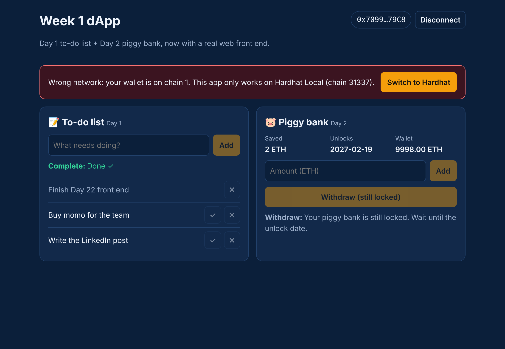

# Day 22 — Next.js dApp

## What I built

A real web app for two Week 1 contracts: the **Day 1 to-do list** and the **Day 2 piggy bank**. You connect a browser wallet (like MetaMask), then add, complete and delete tasks, and lock ETH until a date, from a normal web page. The app is careful about the two things that most often go wrong for users: being on the **wrong network**, and transactions that are **rejected or never happen**.



## How it works

A dApp has two halves: the **contracts** (on the chain) and the **web page** (in your browser). The page never holds your private key. It *asks* your wallet to sign, like a shop asking you to tap your card: you see the amount, and you can say no.

```
 Browser                                     Local chain (Hardhat, id 31337)
┌──────────────────────────────┐             ┌──────────────────────────┐
│ Next.js page (wagmi + viem)  │ ── reads ──▶│ TodoList   (Day 1)       │
│                              │  (own RPC)  │ PiggyBank  (Day 2)       │
│  click "Add" ───┐            │             └──────────────────────────┘
│                 ▼            │                         ▲
│ 1. wallet on chain 31337?  ──┼─ ask wallet live        │
│ 2. enough ETH? dry run ok? ──┼─ own RPC (no pop-up)    │
│ 3. please sign ────────────▶ Wallet ── sends tx ───────┘
│ 4. mined? really ours? ──────┼─ receipt (cancelled? dropped? reverted?)
└──────────────────────────────┘
```

Every write goes through one function, `useSafeWrite` ([`app/lib/useSafeWrite.js`](app/lib/useSafeWrite.js)), in four steps:

1. **Network check, live.** Ask the wallet which chain it is on *right now*. If it is not 31337, stop. The page also shows a red banner with a "Switch" button and disables every write button.
2. **Dry run.** Check the balance, then simulate the call on the app's own RPC. If the contract would refuse ("still locked"), you get the reason in plain words and the wallet never opens.
3. **Sign.** The wallet pops up. If you press Reject, the page says so, keeps what you typed, and unlocks.
4. **Confirm.** Wait for the block, with a time limit, and check the transaction really ran: not reverted, not cancelled or replaced from the wallet.

Reads (your tasks, your savings) never go through the wallet: they come from the app's own RPC for chain 31337, so the page can't show numbers from the wrong network.

## Run it yourself

```bash
cd day-22
npm install && (cd app && npm install)

npm test                 # 37 contract tests + 8 unit tests
npm run test:e2e         # 17 browser tests (starts a node and the app itself)

# Use it by hand:
npm run chain            # terminal 1: local chain on http://127.0.0.1:8545
npm run deploy           # terminal 2: deploy TodoList + PiggyBank
cd app && npm run build && npm run start   # open http://127.0.0.1:3000
```

**With MetaMask:** add a network *Hardhat Local* (RPC `http://127.0.0.1:8545`, chain ID `31337`, symbol ETH) and import one of the test private keys that `npm run chain` prints. These keys are public: **never use them, or this network, with real money.** Try switching MetaMask to Ethereum mainnet: the banner appears and nothing can be sent.

## Results from my run

```
Contracts (Day 1 + Day 2, unchanged)   37 passing
Unit tests (lib/guards.js)             8 pass, 0 fail
Browser tests (Playwright, Chromium)   17 passed (28.7s)
npm audit --omit=dev                   0 vulnerabilities
Slither                                1 note (Day 2's intended call{value:})
```

What the browser tests proved, among others:

- Wallet on chain 1 → banner, all write buttons disabled; after "Switch", the one transaction sent went to chain `0x7a69` (31337) and **0** to chain 1.
- Wallet switches chain **silently** (no event) → the live check refuses: **0** transactions sent.
- Reject in the wallet → "You rejected the request in your wallet. Nothing was sent and nothing changed.", text kept, retry works.
- Withdraw while locked → "still locked", found by the dry run: the wallet never opened.
- Deposit 50,000 ETH from a 10,000 ETH account → "not enough ETH", **0** transactions sent.
- *Cancel* pressed in the wallet → "cancelled… Nothing changed." (before the fix it said **"Done ✓"**).

## What I learned

- **"Sent" is not "done".** A transaction can be rejected, reverted, cancelled from the wallet, replaced or dropped. My first version showed "Done ✓" for a cancelled delete, because the receipt it got back belonged to the *cancel* transaction.
- **Check the network at the last moment, from the wallet.** A banner is good for people; the code that sends must still ask the wallet itself, right before signing.
- **A dry run is not a full check.** Simulation catches contract errors but not "not enough ETH": that needs its own balance check before the wallet pops up.

## Security notes

5 findings fixed (1 high, 2 medium, 2 low), each proven by a failing test first. Details, the attack table and the full output: [QA.md](QA.md).

## References

- [wagmi docs — Connect wallet, `useSwitchChain`, `writeContract`](https://wagmi.sh/react/getting-started)
- [viem — `waitForTransactionReceipt` (`onReplaced`, `timeout`)](https://viem.sh/docs/actions/public/waitForTransactionReceipt)
- [EIP-1193: Ethereum Provider JavaScript API (error 4001, `chainChanged`)](https://eips.ethereum.org/EIPS/eip-1193)
- [EIP-3326: `wallet_switchEthereumChain`](https://eips.ethereum.org/EIPS/eip-3326)
- [Next.js — Content Security Policy](https://nextjs.org/docs/app/guides/content-security-policy)

## Next

Day 23 — **Reading events:** a live activity feed and a simple indexer, built on the events these contracts already emit.
