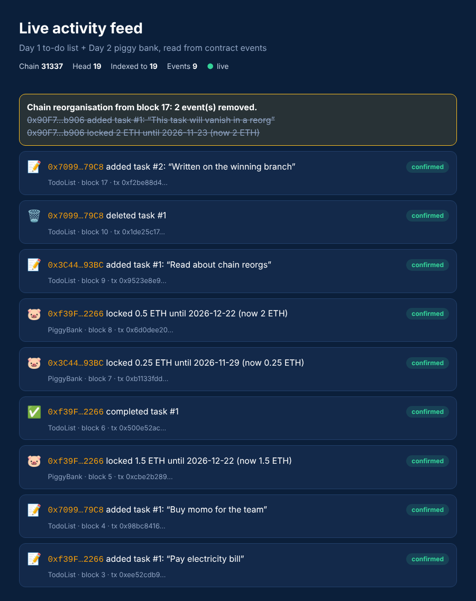

# Day 23 — Reading events

## What I built

A **live activity feed** for the Day 1 to-do list and the Day 2 piggy bank, and the small **indexer** behind it. Every time someone adds a task or locks ETH, the contract writes an *event* (a log line) into the block; the indexer reads those logs, saves them, and the web page shows them within a second. It keeps the feed correct when the chain **reorganises** (recent blocks get replaced) and never **misses** an event, even after a restart.



## How it works

Think of the chain as a notebook where every page is glued to the one before it (each block stores its parent's hash). Events are lines written on the pages. Now and then the last page or two get **torn out and rewritten** — a *reorg*: two validators built on the same block and the network picked the other one. A feed that only ever adds lines would keep showing a task or a deposit that no longer exists.

```
 Contracts (Day 1 + Day 2)        Indexer (Node + viem)                    Browser
┌──────────────────────┐        ┌──────────────────────────────────┐     ┌──────────────┐
│ TodoList  TaskAdded… │ logs   │ 1. reorg check: block at cursor  │     │ feed page    │
│ PiggyBank Deposited… │──────▶ │    still has the saved hash?     │ /api│ polls every  │
└──────────────────────┘        │    no → walk back, delete events │────▶│ second, text │
                                │ 2. head = eth_blockNumber (once) │ feed│ only (no     │
                                │ 3. eth_getLogs [from..to] ranges │     │ innerHTML)   │
                                │    "too big"? halve, never skip  │     └──────────────┘
                                │ 4. save events+cursor+hashes     │
                                │    in ONE atomic write           │
                                └──────────────────────────────────┘
```

- **Reorg check.** The indexer remembers the hash of the last block it read. If that block still has the same hash, every block before it is unchanged too (they are chained by hash). If not, it walks back to the newest saved block that still matches, deletes every event above it, and reads again from there.
- **No missed events.** It polls from a saved cursor instead of listening on a socket (a dropped socket loses events silently). It reads the head once, asks for fixed block ranges, halves a range the RPC refuses, and saves events and cursor together, so a crash can't leave a gap.
- **Pending vs confirmed.** An event shows "pending 1/3" until 3 blocks are on top of it.
- **Read twice.** For each range it reads block `to` before *and* after its logs; if the hash changed in between, the chain moved under it and the range is read again.

Code: [`indexer/indexer.js`](indexer/indexer.js) (≈250 lines, commented) · [`indexer/server.js`](indexer/server.js) · [`public/feed.js`](public/feed.js)

## Run it yourself

```bash
cd day-23
npm install
npm test                 # 30 tests: 18 indexer, 6 fuzz (200 random runs + planted bugs), 6 browser

# Watch it live:
npm run chain            # terminal 1: local chain on http://127.0.0.1:8545
npm run deploy           # terminal 2: deploy TodoList + PiggyBank
npm run feed             # terminal 3: indexer + feed on http://127.0.0.1:4023
npm run activity         # terminal 2: 8 transactions from 3 people
npm run demo:reorg       # terminal 2: 2 blocks appear… then get replaced by a longer branch
```

The browser tests use the Chromium that ships with Playwright 1.63 (`npx playwright install chromium` if you don't have it).

## Results from my run

```
Tests                     30 passing (16 s)
Fuzz                      200 runs · 2,335 random actions · 160 reorgs · 140 restarts
                          756 syncs checked against the chain · 0 mismatches
Planted bugs              6 of 6 caught (no reorg check, ghosts kept, off-by-one,
                          skipped range, height-only check, single read)
Manual demo               8 transactions → 8 events; reorg → 2 events removed, 9 after
Feed lag after a block    0.3–0.7 s  (was 2.7–3.7 s before finding F-01)
npm audit --omit=dev      0 vulnerabilities
Slither                   1 note (Day 2's intended call{value:})
```

## What I learned

- **Block numbers are not identities, block hashes are.** After a reorg, block 17 is still "block 17" with completely different contents. My planted `HeightOnly` bug (reorg = "head went backwards") left a ghost event the fuzz found at once.
- **"Missed events" hide in small places:** a cursor off by one, an RPC that refuses a big range, a `latest` that moves while you read, an indexer that was down for an hour. Polling from a saved cursor with fixed ranges closes all of them.
- **Library defaults matter.** viem caches the block number for 4 s, so my "live" feed was 3–4 s behind. One raw `eth_blockNumber` call fixed it.

## Security notes

2 findings fixed (both low) and 6 planted bugs caught; the reorg and missed-event table, known limits and full output are in [QA.md](QA.md).

## References

- [Ethereum JSON-RPC — `eth_getLogs`](https://ethereum.org/en/developers/docs/apis/json-rpc/#eth_getlogs)
- [viem — `getLogs` and event decoding](https://viem.sh/docs/actions/public/getLogs)
- [Solidity docs — Events](https://docs.soliditylang.org/en/latest/contracts.html#events)
- [ethereum.org — Proof-of-stake: finality and reorgs](https://ethereum.org/en/developers/docs/consensus-mechanisms/pos/#finality)
- [Hardhat Network — `evm_snapshot` / `evm_revert`](https://hardhat.org/hardhat-network/docs/reference#special-testing/debugging-methods)

## Next

Day 24 — **Sign in with Ethereum:** log in with a wallet instead of a password (EIP-4361), safe against signature replay and phishing.
