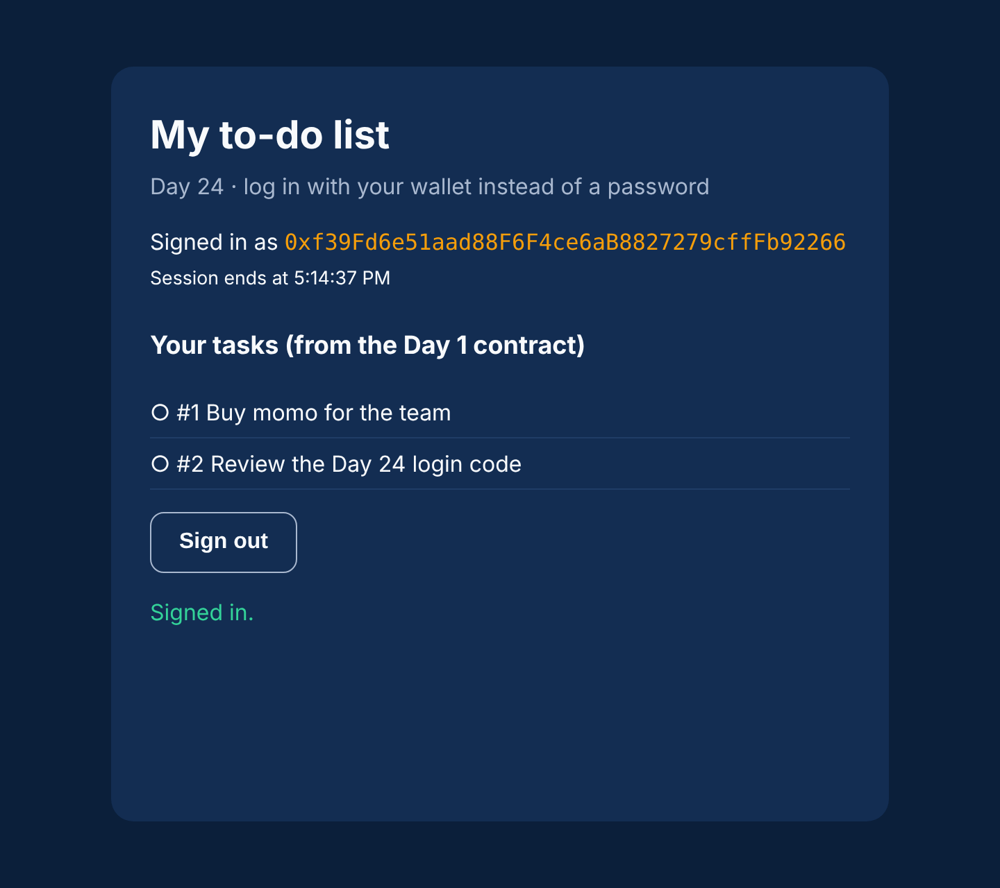

# Day 24 — Sign in with Ethereum

## What I built

A **login page with no password**. You click "Sign in with Ethereum", your wallet shows a short message naming this site and a one-time code, you sign it (free, no transaction), and you are in: the page shows your tasks from the Day 1 to-do contract. It follows the **EIP-4361** standard, works for normal wallets *and* smart-contract wallets (ERC-1271), and is built to refuse **replayed signatures** and **phishing**.



## How it works

A signature only proves *"this key signed this text"*. Everything else — which site, which login, when — has to be **in the text**, and the server must check it. Think of it like signing a cheque: the signature is worthless unless the cheque also says *who* it is for, *how much*, and has a *cheque number* that can only be cashed once.

```
 Browser + wallet                              Server (auth/server.js)
┌────────────────────────┐  1. GET /api/nonce ┌─────────────────────────────────────────┐
│ "Sign in with Ethereum"│ ─────────────────▶ │ random nonce, saved for THIS browser    │
│                        │ ◀───────────────── │ (HttpOnly pre-login cookie, 5 min)      │
│ 2. build EIP-4361 text │                    │                                         │
│    domain = this site  │  3. POST /api/login│ 4. checks (auth/siwe-check.js):         │
│    nonce, chain, times │ ─────────────────▶ │    exact EIP-4361 text? our domain+URI? │
│    wallet signs it     │   message + sig    │    our chain? THIS browser's nonce?     │
└────────────────────────┘                    │    fresh, not expired?                  │
                                              │ 5. burn the nonce (one try, ever)       │
                                              │ 6. signature valid? normal key or       │
        session cookie (HttpOnly,             │    smart wallet (ERC-1271), via viem    │
        SameSite=Strict, ≤ 1 h)  ◀─────────── │ 7. new random session id                │
                                              └─────────────────────────────────────────┘
```

The message the wallet showed in my run:

```
127.0.0.1:4024 wants you to sign in with your Ethereum account:
0xf39Fd6e51aad88F6F4ce6aB8827279cffFb92266

Sign in to the Day 24 to-do app. This costs nothing and sends no transaction.

URI: http://127.0.0.1:4024
Version: 1
Chain ID: 31337
Nonce: 1591851584998597b7cdbd95e83efa3e
Issued At: 2026-11-23T11:19:37.236Z
Expiration Time: 2026-11-23T11:29:37.236Z
```

- **Against replay:** the nonce is random, tied to your browser, used once (burned *before* the signature check, so even two racing requests can't both win), and expires after 5 minutes.
- **Against phishing:** a fake site can trick you into signing, but the message then names the *fake* domain, and this server refuses any domain or URI but its own. Requests from other sites are refused by an `Origin` check and `SameSite=Strict` cookies.
- **Smart wallets:** a contract has no private key, so the server asks the contract itself (`isValidSignature`, ERC-1271). [`contracts/SmartWallet.sol`](contracts/SmartWallet.sol) is a tiny wallet to prove it works.

Code: [`auth/siwe-check.js`](auth/siwe-check.js) (the message checks) · [`auth/server.js`](auth/server.js) (nonces, sessions, routes) · [`public/src/app.js`](public/src/app.js) (the page)

## Run it yourself

```bash
cd day-24
npm install
npm test                 # 40 tests: 4 contract, 28 server, 6 browser, 2 fuzz (550 random runs)
npm run demo             # 2 real sign-ins, then 7 attacks (all refused)
npm run planted-bugs     # plant 12 security bugs one at a time: the tests must catch all 12 (~3 min)

# Try it in your browser with MetaMask:
npm run chain            # terminal 1: local chain on http://127.0.0.1:8545 (chain ID 31337)
npm run deploy           # terminal 2: TodoList (2 tasks for account #0) + a SmartWallet
npm run app              # terminal 2: open http://127.0.0.1:4024
```

In MetaMask, add the network `http://127.0.0.1:8545` (chain ID 31337) and import Hardhat test account #0 (its key is printed by `npm run chain` — a **public test key**, never use it for real funds). Open the page at exactly `http://127.0.0.1:4024`: `localhost:4024` is a different site, and the server will refuse it. The browser tests use the Chromium that ships with Playwright 1.63 (`npx playwright install chromium` if you don't have it). After editing `public/src/app.js`, run `npm run build:web`.

## Results from my run

```
Tests                     40 passing (6 s)
Fuzz                      150 random edits of a signed message → 150 refused (+150 replays refused)
                          400 random field combinations → server agreed with the model 400/400 (42 valid)
Planted bugs              12 of 12 caught (no domain / URI / chain / nonce / expiry check,
                          lenient parser, nonce not burned, no Origin check, session fixation,
                          logout that keeps the session, ecrecover-only, no session cap)
Demo                      2 sign-ins accepted (normal + smart wallet) · 7 of 7 attacks refused
npm audit --omit=dev      0 vulnerabilities
Solhint                   0 problems
Slither                   2 notes, both intended (see QA.md)
```

## What I learned

- **The signature is the easy part; the text is the security.** Domain, URI, chain ID, nonce and times each stop a different attack, and my planted-bug run showed that removing any one of them is a real hole.
- **Parsers can be too kind.** viem's SIWE parser silently ignores an extra `Nonce:` line. I rebuild the message from the parsed fields and demand it is byte-for-byte what was signed.
- **"Valid signature" must include smart wallets.** Plain `ecrecover` locks out every Safe or smart-account user; asking the contract (ERC-1271) fixes it.

## Security notes

2 findings fixed (both low), 8 built-in defences each with a proving test, and 12 planted bugs caught. Details, known limits and full output: [QA.md](QA.md).

## References

- [EIP-4361: Sign-In with Ethereum](https://eips.ethereum.org/EIPS/eip-4361)
- [ERC-1271: Standard Signature Validation Method for Contracts](https://eips.ethereum.org/EIPS/eip-1271)
- [viem — SIWE utilities (`createSiweMessage`, `verifySiweMessage`)](https://viem.sh/docs/siwe/utilities/createSiweMessage)
- [OWASP — Session Management Cheat Sheet](https://cheatsheetseries.owasp.org/cheatsheets/Session_Management_Cheat_Sheet.html)
- [MDN — `SameSite` cookies](https://developer.mozilla.org/en-US/docs/Web/HTTP/Headers/Set-Cookie#samesitesamesite-value)

## Next

Day 25 — **Gasless transactions:** users act without holding ETH while a relayer pays the gas (EIP-712 signed messages), safe against relayer abuse and nonce reuse.
