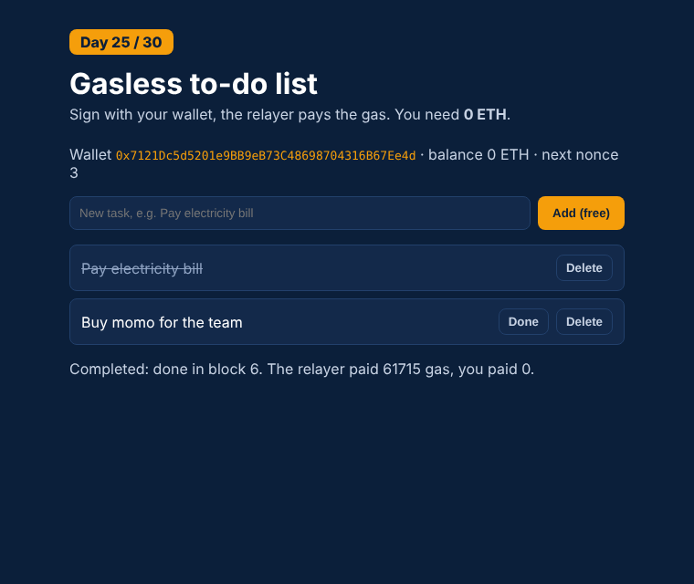

# Day 25 — Gasless transactions

## What I built

A **to-do list you can use with 0 ETH in your wallet**. You type a task, your wallet asks you to *sign* a message (free), and a **relayer** sends the transaction and pays the gas for you. The task is still saved as **yours** on-chain. It uses **EIP-712** signed messages and **ERC-2771** meta-transactions on the Day 1 to-do list, and it is built so that nobody can **reuse your signature** (nonce reuse) and nobody can **trick the relayer into wasting its ETH** (relayer abuse).



## How it works

Think of a **signed cheque and a courier**. You write and sign the cheque (the request); the courier (relayer) carries it to the bank (the Forwarder contract) and pays the bus fare (gas). The bank checks your signature and the cheque number, so the courier can deliver it but can't change it or cash it twice.

```
 You (0 ETH)                    Relayer (pays gas)                   Chain
┌──────────────────┐ 1. sign   ┌──────────────────────────┐ 4. send ┌───────────────────────────────┐
│ "add task: Buy   │  EIP-712  │ 2. checks it's worth it: │ ──────▶ │ Forwarder.execute()           │
│  momo", nonce 3, │ ────────▶ │  our to-do app only, 3    │         │  signature = from? nonce = 3? │
│  deadline 10 min │  (free)   │  functions, value 0, gas  │         │  deadline? target trusts me?  │
└──────────────────┘           │  cap, 10/min per signer   │         │  enough gas? → nonce = 4      │
                               │ 3. simulate: would it     │         │       │ call + your address   │
                               │  fail? then refuse, free  │         │       ▼ in the last 20 bytes  │
                               └──────────────────────────┘         │ GaslessTodoList: _msgSender() │
                                                                     │  = you (only via Forwarder)   │
                                                                     └───────────────────────────────┘
```

- **What you sign** (EIP-712, shown nicely by the wallet): `from, to, value, gas, nonce, deadline, data`, plus the chain ID and the Forwarder's address. Change any of it and the signature no longer matches.
- **Against nonce reuse:** each user has a counter in the Forwarder (0, 1, 2…). A request only runs if its nonce is the next one, and the counter moves **before** the call. Replays, out-of-order and "twin" requests with the same nonce all fail.
- **Against relayer abuse:** the relayer only pays for *our* contract and its 3 write functions, never sends ETH, caps gas and deadlines, rate-limits by the **real** signer, and **simulates first**, so it never pays for a request that would fail.
- **Against a cheating relayer:** the Forwarder checks it forwards exactly `value` and the **full** `gas` (no "under-funded" relays), and copies no return data (no "return bomb").

Code: [`contracts/Forwarder.sol`](contracts/Forwarder.sol) · [`contracts/GaslessTodoList.sol`](contracts/GaslessTodoList.sol) (Day 1 list, `msg.sender` → `_msgSender()`) · [`relayer/server.js`](relayer/server.js) · [`public/app.js`](public/app.js)

## Run it yourself

```bash
cd day-25
npm install
npm test                 # 42 tests: 19 contract, 17 relayer, 4 browser, 2 fuzz
npm run demo             # a 0-ETH user adds and completes tasks, then 9 attacks (all refused)
npm run planted-bugs     # plant 20 security bugs one at a time: the tests must catch all 20 (~8 min)

# Try it in your browser with MetaMask:
npm run chain            # terminal 1: local chain on http://127.0.0.1:8545 (chain ID 31337)
npm run deploy           # terminal 2: Forwarder + GaslessTodoList
npm run relayer          # terminal 2: open http://127.0.0.1:4025
```

In MetaMask, add the network `http://127.0.0.1:8545` (chain ID 31337) and create a **new, empty account**: it needs no ETH. The relayer uses the node's dev account #9 unless you set `RELAYER_PRIVATE_KEY` (see `.env.example`; test keys only). The browser tests use the Chromium that ships with Playwright 1.63 (`npx playwright install chromium` if you don't have it).

## Results from my run

```
Tests                     42 passing (12 s)
Gasless actions           3 done by a 0-ETH user · relayer paid 0.0006 ETH (185,929 + 134,665 + 63,545 gas)
Attacks                   9 of 9 refused · 0 transactions paid for them
Fuzz                      150 random tamperings → 150 refused, 0 paid
                          40 random sequences (186 commands) → matched the model; paid tx = accepted
Gas griefing scan         101 gas limits from 100k to 300k → never "done" without doing the work
Planted bugs              20 of 20 caught (10 on-chain, 9 relayer, 1 page)
npm audit --omit=dev      0 vulnerabilities
Solhint                   0 problems
Slither                   3 notes (assembly, intended — see QA.md)
```

## What I learned

- **The signature protects the user; the policy protects the relayer.** On-chain checks stop anyone from changing or replaying your request, but only the relayer's own rules (one app, three functions, value 0, gas cap, simulate first) stop it from paying for junk.
- **The popular gas check wasn't enough.** Checking gas *after* the call misses a target that catches its own out-of-gas error. My scan of 101 gas limits found it; checking *before* the call fixed it.
- **Rate-limit the signer, not the claim.** Counting by the `from` field would let anyone burn a victim's quota with forged requests. Recover the signer first, then count.

## Security notes

2 findings fixed (1 medium, 1 low), 1 info, 11 built-in defences each with a proving test, and 20 planted bugs caught. Details, known limits and full output: [QA.md](QA.md).

## References

- [EIP-712: Typed structured data hashing and signing](https://eips.ethereum.org/EIPS/eip-712)
- [ERC-2771: Secure Protocol for Native Meta Transactions](https://eips.ethereum.org/EIPS/eip-2771)
- [OpenZeppelin Contracts — Meta Transactions (ERC2771Context, ERC2771Forwarder)](https://docs.openzeppelin.com/contracts/5.x/api/metatx)
- [OpenZeppelin — ERC-2771 + Multicall address spoofing disclosure](https://blog.openzeppelin.com/arbitrary-address-spoofing-vulnerability-erc2771context-multicall-public-disclosure)
- [SWC-126: Insufficient Gas Griefing](https://swcregistry.io/docs/SWC-126)

## Next

Day 26 — **Layer 2 & cross-chain:** two local chains, comparing costs on an L2-style chain and sending a message between them, safe against replay across chains.
