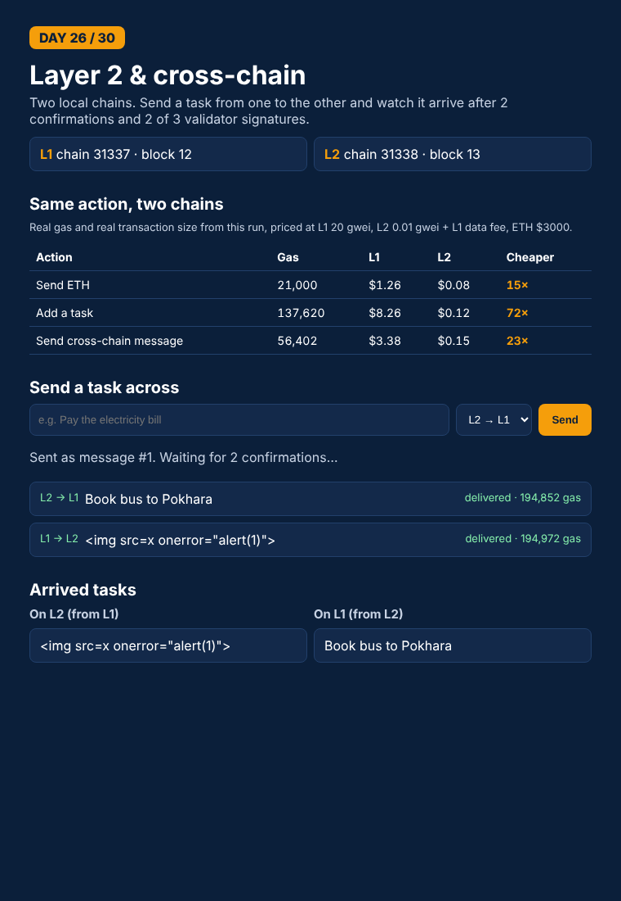

# Day 26 — Layer 2 & cross-chain

## What I built

**Two local blockchains** running side by side: an "L1" (like Ethereum, chain ID 31337) and an "L2-style" chain (like a rollup, chain ID 31338). First I ran the **same actions on both** and priced them with the real L2 fee formula: the gas is identical, but the L2 is **15× to 72× cheaper**. Then I built a small **cross-chain messenger**: you add a task on one chain and it appears in your Day 1 to-do list on the other, once and only once, signed by **2 of 3 validators**, and safe against **replay across chains**.



*From the browser test: the L1 → L2 task is an XSS test string, shown as plain text.*

## How it works

**Why an L2 is cheaper.** Think of a parcel service. On L1 every parcel gets its own truck (you pay gas × the L1 gas price). On an L2 the local van is almost free (gas × a tiny L2 price), but the parcel still needs space on the big ship to the main warehouse: the L2 posts your transaction's **bytes** to L1 so anyone can re-check it. So an L2 fee is **execution + L1 data**, and the data part is 96–99% of it. Smaller transactions save the most.

**How a message crosses.** Like a registered letter between two post offices:

```
 L1 (31337)                     off-chain                              L2 (31338)
┌─────────────────────────┐   ┌──────────────────────────────────┐   ┌──────────────────────────────────┐
│ Messenger.sendMessage   │   │ relayer finds the event, waits   │   │ Messenger.receiveMessage         │
│  "Pay electricity bill" │──▶│  for 2 confirmations (reorgs)    │──▶│  1 to THIS chain + THIS messenger│
│  → event: src 31337,    │   │ each validator checks it ALONE:  │   │  2 from the TRUSTED L1 messenger │
│    dst 31338, nonce 0,  │   │  real tx? from the real          │   │  3 never delivered before        │
│    sender, target, text │   │  Messenger? confirmed? same id?  │   │  4 2 of 3 validators signed it   │
└─────────────────────────┘   │  → signs the id                  │   │  → mark done, then call          │
                              │ relayer: 2 sorted signatures,    │   │ CrossChainTodo.onMessage         │
                              │  simulate, send (pays L2 gas)    │   │  only from Messenger, only from  │
                              └──────────────────────────────────┘   │  L1, stored under (31337, you)   │
                                                                      └──────────────────────────────────┘
```

- **Against replay across chains:** the message id (what validators sign) includes **both chain IDs and both messenger addresses**. A signature for L2 is useless on L1, on a second messenger on L2, or with any field changed. Each id is delivered once (`processed`), marked **before** the call.
- **Against bridge risks:** one stolen validator key is not enough (2 of 3, each signer counted once, malleable signatures refused); only the one trusted messenger per chain is accepted; validators refuse fake events and messages a reorg removed; the owner can pause; the app keeps remote tasks under **(chain, address)** so an address on L1 can never write into someone's L2 list.
- **The relayer is not trusted:** it can't change a message, only deliver it or not. It simulates first, retries failed messages without blocking the ones behind them, and only pays for our own app.

Code: [`contracts/Messenger.sol`](contracts/Messenger.sol) · [`contracts/CrossChainTodo.sol`](contracts/CrossChainTodo.sol) · [`relayer/relayer.js`](relayer/relayer.js) (viem) · [`lib/gas-model.js`](lib/gas-model.js) · [`app/`](app/)

## Run it yourself

```bash
cd day-26
npm install
npm test                 # 38 tests on 2 real local chains: 23 contract, 9 relayer + cost model, 4 browser, 2 fuzz
npm run demo             # starts L1 + L2, cost table, a message each way, 9 attacks (all refused)
npm run app              # starts L1 + L2 + relayers, open http://127.0.0.1:4026 and send tasks across
npm run planted-bugs     # plants 21 security bugs one at a time: the tests must catch all 21 (~5 min)
```

`npm run demo` and `npm run app` start two `hardhat node` processes themselves (ports 8545 and 8546), so stop any other local chain first. The browser test uses the Chromium that ships with Playwright (`npx playwright install chromium` if you don't have it).

## Results from my run

```
Tests                     38 passing (32 s) on 2 real local chains: 23 contract, 9 relayer + cost model,
                          4 browser, 2 fuzz
Costs (same action)       Gas (L1 = L2)  Tx bytes  L1 cost  L2 cost (exec + L1 data)  Cheaper
  Send ETH                       21,000       118    $1.26    $0.08 (1% + 99%)            15×
  Add a task                    137,620       213    $8.26    $0.12 (4% + 96%)            72×
  Send cross-chain message       56,402       341    $3.38    $0.15 (1% + 99%)            23×
  (assumed: L1 20 gwei, L2 0.01 gwei, ETH $3,000, OP Bedrock L1 data fee)
Messages                  L1 → L2 and L2 → L1 delivered after 2 confirmations, 2 of 3 signatures
                          (~195,000 gas to deliver; 0 delivered before 2 confirmations)
Attacks                   9 of 9 refused (replay here, on the other chain, on a twin messenger,
                          tampered text, 1 stolen key, double signer, unknown chain, fake event,
                          direct onMessage call)
Fuzz                      150 random one-field tamperings → 150 refused
                          30 random sequences (209 commands, 51 deliveries) → every message
                          delivered exactly once, in order, never mixed into local lists
Planted bugs              21 of 21 caught (14 on-chain, 5 relayer, 2 page/server)
npm audit --omit=dev      0 vulnerabilities
Solhint                   0 problems
Slither                   0 results
```

## What I learned

- **An L2 doesn't make the EVM cheaper, it makes block space cheaper.** The same `addTask` used exactly 137,620 gas on both chains. The saving comes from the price, and 96% of the L2 fee is paying L1 for the transaction's bytes.
- **A signature must say where it is going.** If the signed message didn't include the destination chain and messenger, the same signatures would work on every copy of the bridge. My planted bug that dropped the chain ID from the id was caught by the "re-address" test.
- **One stuck message can freeze a bridge.** My first relayer stopped at a failing message to keep things in order. A message to a contract that always reverts (or a 101st task) would have blocked everyone forever. Now failed messages wait in a retry list and the rest keep flowing.

## Security notes

3 findings fixed (1 medium, 2 low), 12 built-in defences each with a proving test, 21 planted bugs caught, plus known limits (a real bridge needs fees, finality and a multisig). Details and full output: [QA.md](QA.md).

## References

- [Ethereum.org — Layer 2 / rollups](https://ethereum.org/en/layer-2/)
- [Optimism docs — Transaction fees (execution + L1 data fee)](https://docs.optimism.io/stack/transactions/fees)
- [EIP-155: Simple replay attack protection (chain ID)](https://eips.ethereum.org/EIPS/eip-155)
- [EIP-2028: Transaction data gas cost reduction (16/4 gas per byte)](https://eips.ethereum.org/EIPS/eip-2028)
- [Chainalysis — Cross-chain bridge hacks (Ronin, Nomad, Wormhole)](https://www.chainalysis.com/blog/cross-chain-bridge-hacks-2022/)

## Next

Day 27 — **Monitoring & alerts:** a dashboard that watches a contract and flags unusual activity, like admin key misuse and unusual withdrawals.
