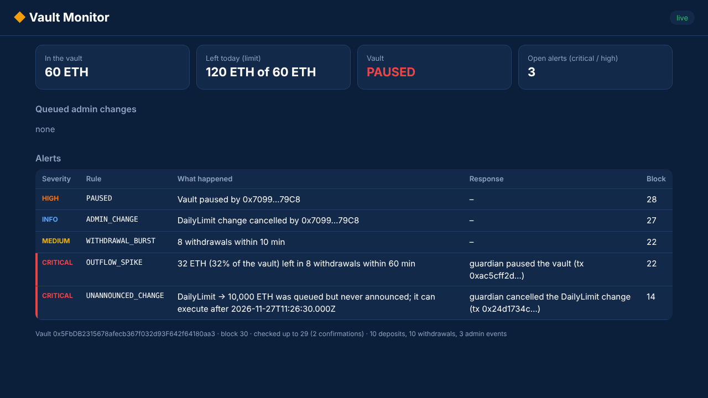

# Day 27 — Monitoring & alerts

## What I built

A **community ETH vault built to be watched**, and a **monitor with a live dashboard** that watches it. The monitor reads every event (with viem), runs 9 alert rules for **admin key misuse** and **unusual withdrawals**, and when something is critical it **acts on its own** with a limited "guardian" key: it pauses the vault or cancels a suspicious admin change before it can take effect.



*From the browser test: a stolen owner key queued a 10,000 ETH/day limit (cancelled), then 10 addresses took 4 ETH each (vault paused).*

## How it works

Think of a shop with a CCTV room. The camera alone doesn't stop a thief; it helps because **the shop is built to slow the thief down** (a locked back room, a cash limit per till) and **someone in the CCTV room can lock the door**. So there are two halves:

**1. The vault gives the monitor something to see, and time to react** ([`contracts/GuardedVault.sol`](contracts/GuardedVault.sol))
- Members deposit and withdraw only their own ETH (Day 2 rule: checks → effects → interaction, plus a re-entrancy guard).
- **Every admin change waits 24 hours** (a timelock) and emits `ChangeQueued` with the time it can run.
- A **guardian** key (held by the monitor) can only **pause** and **cancel queued changes**. It can't unpause, change settings or touch funds, so a stolen guardian key can stop the vault but never drain it.
- A **net daily limit**: at most 60 ETH may leave per day (minus what came in that day), so even a successful attack is capped.

**2. The monitor watches and responds** ([`monitor/`](monitor/))

```
 Hardhat chain                 monitor (viem)                                          you
┌──────────────┐   logs   ┌────────────────────────────────────────────────┐   JSON  ┌───────────────┐
│ GuardedVault │────────▶ │ wait 2 confirmations · only the vault's address│───────▶ │ dashboard     │
│  Deposited   │          │ → rules (pure functions, block time):          │         │ 127.0.0.1:4027│
│  Withdrawn   │          │   LARGE_WITHDRAWAL   one tx ≥ 20% of the vault │         │ tiles, queued │
│  ChangeQueued│          │   OUTFLOW_SPIKE      ≥ 30% out within 1 hour   │         │ changes,      │
│  Paused …    │          │   WITHDRAWAL_BURST   ≥ 8 withdrawals in 10 min │         │ alerts +      │
└──────▲───────┘          │   DAILY_LIMIT_NEAR   80% of today's limit used │         │ responses     │
       │                  │   UNANNOUNCED_CHANGE admin change nobody planned│        └───────────────┘
       │ pause() /        │   UNKNOWN_ADMIN · OWNERSHIP · PAUSED/UNPAUSED  │
       │ cancel(kind)     │ → save cursor + rule state (restart-safe)      │
       └──────────────────│ → critical? guardian key responds              │
                          └────────────────────────────────────────────────┘
```

- **Admin key misuse:** the owner announces planned changes in the monitor's config. Anything else queued is `UNANNOUNCED_CHANGE` (critical) and the guardian **cancels it** while it is still waiting in the timelock. Admin actions from an address that isn't a known admin pause the vault.
- **Unusual withdrawals:** a thief splits a drain into many small withdrawals from many addresses, so each one looks normal. The outflow rule adds them up over a rolling hour; when 30% of the vault has gone, the guardian **pauses** the vault.
- **Never miss, never double count:** the monitor saves its last block and rule state after every chunk; a restart continues exactly there. Each alert has an id (rule + tx + log index), so it can't fire twice.

Code: [`monitor/rules.js`](monitor/rules.js) (the alert rules) · [`monitor/monitor.js`](monitor/monitor.js) (reading, responding) · [`monitor/server.js`](monitor/server.js) + [`monitor/public/`](monitor/public/) (dashboard)

## Run it yourself

```bash
cd day-27
npm install
npm test                 # 37 tests: 15 contract, 17 monitor on a live chain, 3 browser, 2 fuzz
npm run demo             # a normal day, then admin key misuse and a split drain, watched live
npm run app              # dashboard at http://127.0.0.1:4027 — attacks start after ~20 s (Ctrl+C to stop)
npm run planted-bugs     # plants 21 security bugs one at a time: the tests must catch all 21 (~3 min)
```

The browser tests use the Chromium that ships with Playwright (`npx playwright install chromium` if you don't have it).

## Results from my run

```
Tests                     37 passing (7 s): 15 contract, 17 monitor (viem on a live chain), 3 browser, 2 fuzz
Demo (npm run demo)       10 members, 120 ETH, 60 ETH/day net limit, 2 confirmations
  1 normal day            6 deposits + 6 withdrawals over 12 hours  → 0 alerts
  2 admin key misuse      owner key queues a 10,000 ETH/day limit   → CRITICAL UNANNOUNCED_CHANGE,
                                                                       guardian cancelled it 3 blocks later
  3 split drain           9 addresses × 4 ETH (each looks small)    → CRITICAL OUTFLOW_SPIKE (36 ETH, 31.57%),
                                                                       MEDIUM burst, vault paused 3 blocks
                                                                       after the last drain tx; next one refused
  4 whale takes 25 ETH    one member, own money                      → HIGH LARGE_WITHDRAWAL (no pause)
  5 look-alike contract   fake 1,000 ETH Withdrawn event             → ignored
  Summary                 17 deposits, 16 withdrawals, 4 admin events → 7 alerts (2 critical, 3 high, 1 medium, 1 info)
  Gas                     deposit 59,979 · withdraw 57,193 · pause 46,860
Fuzz                      400 random withdrawal sequences: 864 drain moments, 0 missed, 0 false alarms, no spam
                          25 random live runs with 130 random crashes → alerts identical to a monitor that never stopped
Planted bugs              21 of 21 caught (9 contract, 10 monitor, 2 dashboard)
npm audit --omit=dev      0 vulnerabilities
Solhint                   0 problems
Slither                   0 results
```

## What I learned

- **Monitoring only works if the contract gives you time.** An alert about an admin change that already happened is a post-mortem. The 24-hour timelock is what turns "we saw it" into "we cancelled it".
- **Attackers split their moves to stay under thresholds.** A rule that looks at one withdrawal at a time is easy to dodge; a rolling window over all addresses is not. And a mute ("one alert per hour") can itself be abused: a small first spike hid a much bigger drain until I made the alert fire again when the outflow doubles.
- **A circuit breaker can become a weapon.** My first daily limit let one rich member withdraw the whole limit, put it back, and lock everyone else out every day for the price of gas. Counting the *net* outflow fixed it.

## Security notes

4 findings fixed (2 medium, 2 low), 21 planted bugs caught, plus known limits (deep reorgs, a single owner key, a monitor that is itself a target). Details and full output: [QA.md](QA.md).

## References

- [OpenZeppelin — Monitor (Defender) docs: sentinels, conditions and autotask responses](https://docs.openzeppelin.com/defender/module/monitor)
- [Forta Network — detection bots for on-chain threats](https://docs.forta.network/en/latest/)
- [ERC-7265: Circuit Breaker (rate-limiting outflows)](https://ethereum-magicians.org/t/eip-7265-circuit-breaker/14909)
- [OpenZeppelin Contracts — `Ownable2Step`, `Pausable`, `TimelockController`](https://docs.openzeppelin.com/contracts/5.x/api/access)
- [viem — `getLogs` and `decodeEventLog`](https://viem.sh/docs/actions/public/getLogs)

## Next

Day 28 — **Capstone, part 1:** the design and smart contracts for a dApp that solves a real problem in Nepal, with full tests.
