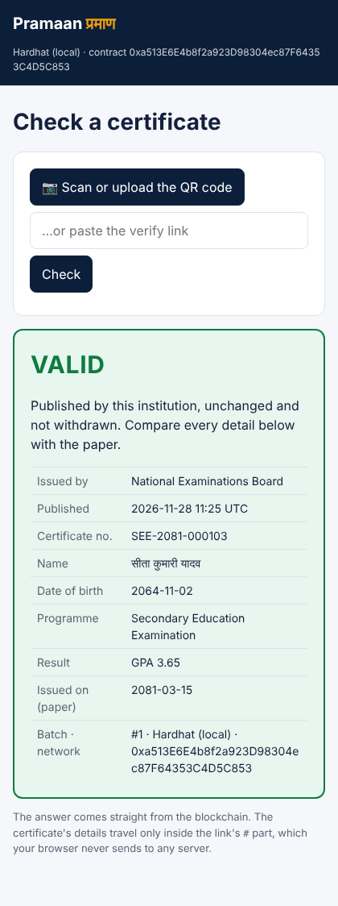
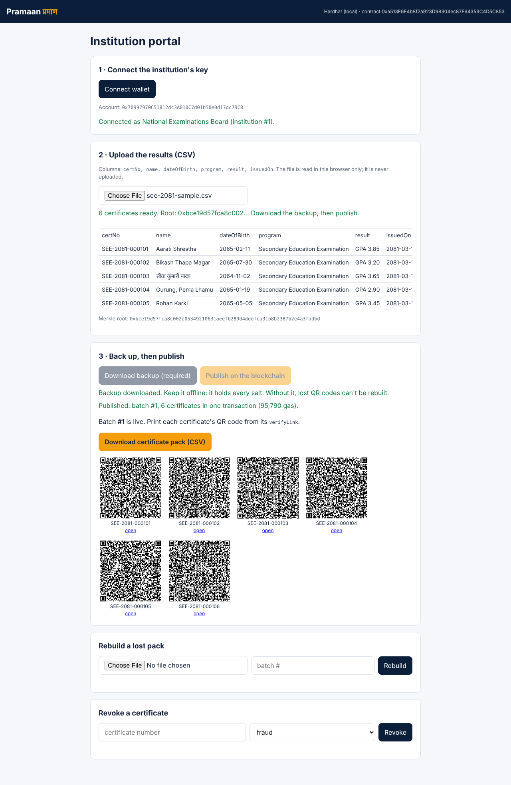

# Day 29 — Capstone, part 2: the Pramaan web app

## What I built

The website for **Pramaan** (प्रमाण, "proof"), my capstone against fake academic certificates in Nepal. A board like NEB uploads its exam results as a CSV and publishes the whole file in **one transaction**, then gets a QR code link for every certificate. An employer, an agency or an embassy scans the QR on the paper and sees **VALID**, **REVOKED**, **DISTRUSTED** or **NOT FOUND** in seconds, with no account and no wallet. It comes with end-to-end browser tests and a deploy kit for the Sepolia test network.

The code is in [`capstone/app/`](../capstone/app). Day 28 (design + contract): [day-28](../day-28) · design: [DESIGN.md](../capstone/DESIGN.md).

| Verifier (phone) | Institution portal |
|---|---|
|  |  |

*Both screenshots are from the end-to-end test run (fictional students).*

## How it works

Think of a bank cheque. The bank doesn't keep a copy of every cheque in your wallet; it can still tell you in seconds whether one is real. Pramaan works the same way: the chain keeps only fingerprints, the paper carries the details, and the website compares the two.

**Institution portal** ([`portal.html`](../capstone/app/public/portal.html) · [`src/portal.js`](../capstone/app/src/portal.js))
1. **Connect** the institution's wallet. The page checks the network and reads from the chain which institution this key belongs to (only council-registered keys can publish).
2. **Upload the CSV.** It is read **in the browser only**: every row is checked (empty cells, too long, duplicate numbers, with line numbers), then each certificate gets a random 32-byte *salt* and a fingerprint, and all fingerprints become one Merkle root (Day 10's trick).
3. **Download the backup** (all salts). Publishing stays locked until you do: without the salts, lost QR codes could never be made again.
4. **Publish**: one `issueBatch(root, count)` transaction. The only thing that leaves the browser is the root and the count.
5. **Download the pack**: a CSV with a `verifyLink` per certificate for printing as QR codes. Lost it? Rebuild it from the backup, after the page checks it matches the batch on-chain. Revoking a certificate is one more form.

**Verifier** ([`verify.html`](../capstone/app/public/verify.html) · [`src/verify.js`](../capstone/app/src/verify.js))
- Scan the QR (the phone camera takes a photo; the page reads the code with jsQR) or paste the link.
- The page recomputes the fingerprint from the details in the QR and asks the contract (free, read-only, through viem).
- It shows the answer, the institution's **on-chain** name and the details to compare with the paper.

```
 Institution's browser                        Chain (Pramaan.sol)              Verifier's phone
 CSV ─▶ check rows ─▶ salt + hash each
      ─▶ Merkle root ─▶ backup (salts) ─▶ issueBatch(root, 6) ──▶ batch #1
      ─▶ pack: verify.html#c=<payload>  ─▶ printed QR ─────────────────────────▶ scan / paste
                                              batches(1).issuerId ◀── who really owns it?
                                              verifyInBatch(...)  ◀── recomputed hash + proof
                                                         └────────────────────▶ VALID / REVOKED /
                                                                                 DISTRUSTED / NOT FOUND
 The certificate travels in the link's #fragment: browsers never send it to any server.
```

**Deploy kit** ([`capstone/DEPLOY.md`](../capstone/DEPLOY.md)): `.env.example`, `npm run deploy:sepolia` (deploys, writes `deployments/sepolia.json` and the app's `config.json`), the Etherscan verify command, `npm run council` (register, suspend, rotate, report a stolen key; prints Safe multisig calldata when the council is a multisig), `npm run build:app`, and hosting steps with the security headers. The app is plain static files: any static host works.

## Run it yourself

```bash
cd capstone
npm install
npm test               # 58 tests: 38 contract/library (Day 28) + 11 app + 9 end-to-end in Chromium (~15 s)
npm run app            # local chain + contract + web app: http://127.0.0.1:4029 (Ctrl+C to stop)
                       #   portal → "Use local test wallet" → upload app/sample/see-2081-sample.csv
                       #   → download backup → publish → open a verify link
npm run planted-bugs   # plants 36 security bugs one at a time: the tests must catch all 36 (~6 min)
npm run lint && npx hardhat compile && npm run slither
```

The browser tests use the Chromium that ships with Playwright (`npx playwright install chromium` if you don't have it). To deploy to Sepolia from your laptop, follow [DEPLOY.md](../capstone/DEPLOY.md).

## Results from my run

```
Tests                     58 passing (15 s): 38 contract + library, 11 app (QR payload + CSV), 9 end-to-end
End-to-end (Chromium + Hardhat JSON-RPC node)
  publish                 6 results from a CSV in ONE transaction: 95,790 gas; an impatient double click → still 1 tx
  scan                    the QR image the portal drew → decoded in the browser → VALID
  every link              6 of 6 VALID (Devanagari name, a name with a comma)
  forged grade            GPA 3.20 → 4.00 in the QR → NOT FOUND, and the fake details are not shown
  revoked for fraud       from the portal → REVOKED (reason: fraud)
  stolen key              fake → DISTRUSTED · rogue college claiming to be NEB → NOT FOUND (F-5)
  privacy                 every browser request checked: no name, no salt; the server never saw a certificate
  wrong network · rejected tx · suspended institution · not an institution · bad CSV · RPC down · XSS → all handled
QR size                   6-certificate batch: 387-character link (QR version 15)
                          10,000-certificate batch: 1,000–1,123 characters (QR version 27, print ≥ 4 cm)
Deploy kit (dry run)      deploy:local 1,772,819 gas · council add-issuer 120,009 gas · duplicate key refused before sending
Fuzz                      200 payload round trips · 500 random strings (none half-valid) · 300 random CSV tables
Planted bugs              36 of 36 caught (18 contract, 4 hashing library, 14 web app)
npm audit --omit=dev      0 vulnerabilities
Solhint                   0 problems
Slither                   0 results
```

## What I learned

- **A correct contract can still sit behind a lying page.** The contract tied every batch to its real institution, but my page printed the name for the id *in the QR*. A small college could have sold "NEB" certificates. The fix: show only what the chain says about who owns the batch.
- **"Couldn't check" and "fake" are different answers.** If the RPC is down, telling an employer "NOT FOUND" could cost a real graduate a job abroad. The page now checks the chain id and contract first and says "could not check" on any error.
- **The `#` part of a URL is a privacy feature.** Putting the certificate in the link's fragment means no web server, proxy or log ever sees a student's name, and the end-to-end test proves it.

## Security notes

2 findings fixed (1 high, 1 low), 14 new planted bugs caught (36 in total), one weak test strengthened, and known limits (QR size for big batches, trusting the site and RPC, the backup file) written down. Details and full output: [QA.md](QA.md).

## References

- [viem — `readContract`, `simulateContract`, `writeContract`](https://viem.sh/docs/contract/readContract)
- [EIP-1193 — Ethereum Provider JavaScript API](https://eips.ethereum.org/EIPS/eip-1193)
- [OWASP — Cross-Site Scripting prevention cheat sheet](https://cheatsheetseries.owasp.org/cheatsheets/Cross_Site_Scripting_Prevention_Cheat_Sheet.html)
- [OWASP — CSV injection](https://owasp.org/www-community/attacks/CSV_Injection)
- [Hardhat — verifying contracts on Etherscan](https://hardhat.org/hardhat-runner/docs/guides/verifying)

## Next

Day 30 — **Capstone, part 3:** the full self-audit report (`capstone/AUDIT.md`), a demo walkthrough on a test network, and the 30-day wrap-up.
